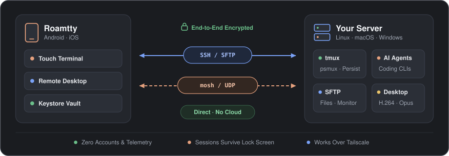
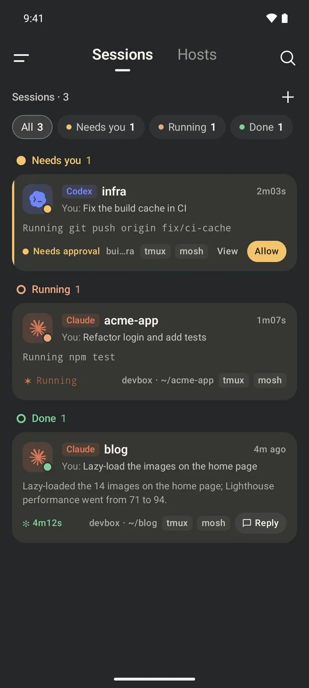
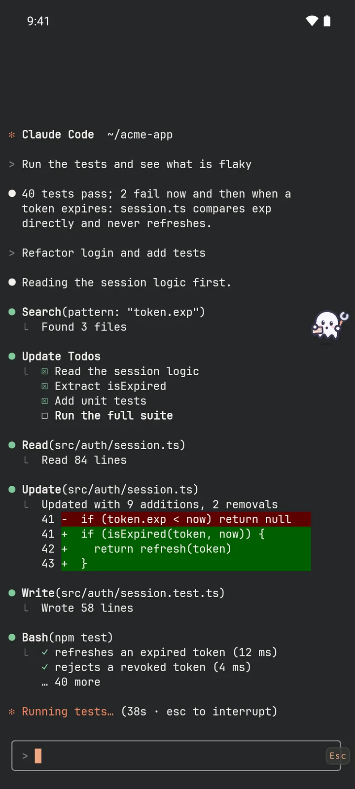
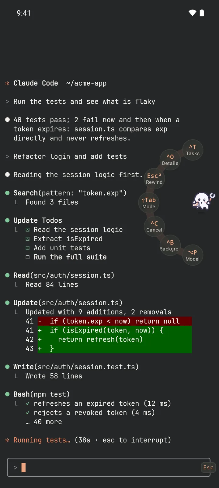
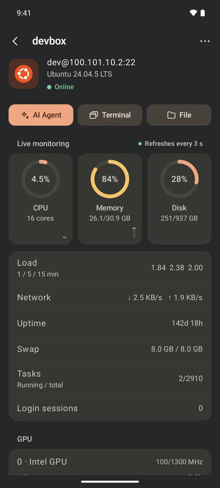

# Roamtty

**English** | [简体中文](README.zh-CN.md)

Mobile SSH, terminal, and remote desktop client for Android — built for remote AI coding (`Claude Code`, `Codex`, `Grok`, `Antigravity`).

`Android 8.0+ (API 26)` · `Kotlin + Compose` · `com.roamtty.app` · [Website](https://roamtty.com/en/) · [iOS Client](https://github.com/yahaa/roamtty-ios) · [Desktop Plugin](https://github.com/yahaa/roamtty-desktop)



<p align="center">
  
  
  
  
</p>

## Highlights

- **Hosts & Trust** — Password, interactive auth, or OpenSSH/PEM private keys (Ed25519, RSA, encrypted keys). Auto-detects OS, online status, and TCP connect latency. Strict TOFU SHA-256 fingerprint pinning blocks changed host keys until explicit re-verification.
- **Persistent Sessions** — Independent `tmux` (POSIX) or `psmux` (Windows) sessions (up to 8 per host) survive lock screens and disconnects. Prefers `mosh` over UDP (60000–61000) with 8 s fallback to SSH. One-tap plugin installer included.
- **AI Coding Agents** — Launch `Claude Code`, `Codex`, `Grok`, or `Antigravity CLI` directly into a remote folder with Plan/Read-only, Standard, or YOLO permissions. Session cards track task title, live status (`Needs you` / `Running` / `Done`), running command, and notifications.
- **Touch-First Terminal** — Gestures for Tab, paste, history scroll, cursor drag, arrow keys, and pinch zoom. Floating Ghost button opens the action bar (upload/download, insert up to 9 images, remote shell history, draft editor) on tap and a context-aware shortcut ring on hold.
- **Remote Desktop** — One-tap host setup via [`roamtty-desktop`](https://github.com/yahaa/roamtty-desktop) with H.264 video, Opus audio, UDP + Reed-Solomon FEC (auto-fallback to SSH), and Mac-style multi-touch gestures (Linux X11 / wlroots Wayland, macOS 13+, Windows 10/11).
- **Files, Monitor & Port Preview** — SFTP browser with syntax-highlighted code, Markdown, and image previews; share-sheet image upload; live CPU/memory/disk/network/GPU/process monitor; SSH loopback preview for remote `localhost` web servers.

> Roamtty runs no models and no local Linux shell — everything runs on your own servers. No cloud sync, port-forwarding UI, or jump hosts.

## Privacy & Security

- **Local-only**: no accounts, no ads, no analytics, no telemetry, no backend server.
- **Hardware-backed vault**: saved passwords and keys are encrypted with AES-256-GCM using a non-exportable Android Keystore key (AAD bound to host ID and field purpose). Key passphrases are never stored.
- **Minimal persistence**: terminal buffers, drafts, and command history stay in memory only; Android backup/transfer is disabled and remote OSC 52 clipboard writes are blocked.
- Full disclosures: [Privacy Policy](docs/PRIVACY.md) ([roamtty.com/privacy](https://roamtty.com/privacy/)).

## Build & Test

Requires **JDK 17**, **Android SDK 36**, and **build-tools 36.0.0** (pinned in `toolchains.lock.json`).

```sh
# Build debug APK and lint
./gradlew :app:assembleDebug :app:lint

# Run all JVM unit tests
./gradlew :app:testDebugUnitTest :ssh-core:test :desktop-core:test :code-core:test \
  :terminal-emulator:testDebugUnitTest :terminal-view:testDebugUnitTest
```

See [Development & Testing](docs/DEVELOPMENT.md) for instrumented tests, E2E regression (`scripts/e2e/run.sh`), Windows fixtures, and release signing.

## Documentation

| Document | Description |
| --- | --- |
| [User Guide](docs/USER_GUIDE.md) ([中文](docs/USER_GUIDE.zh-CN.md)) | Setup, AI agents, terminal gestures, remote desktop, files, and FAQ |
| [Desktop Gestures](docs/desktop-gestures.md) | Touch/trackpad gesture spec, parameters, and live test commands |
| [Architecture](docs/ARCHITECTURE.md) | Module layers, transport backpressure, security, hooks, and Termux pin |
| [Development & Testing](docs/DEVELOPMENT.md) | Toolchains, unit/device/E2E test suites, and release signing |
| [Google Play Release](docs/GOOGLE_PLAY_RELEASE.md) | Play Console requirements, FGS declaration, and release checklist |
| [Privacy Policy](docs/PRIVACY.md) | Bilingual legal privacy policy bundled in the app and on roamtty.com |
| [Third-Party Notices](THIRD_PARTY_NOTICES.md) | Open-source licenses for bundled libraries, fonts, and artwork |

## License

The original code in this version is source-available under the [PolyForm Shield License 1.0.0](LICENSE). You may view, use, and modify the code within permitted terms, but you may not use it to provide competing products or services (including free competitors). It is not an OSI open-source license.

Third-party components retain their own licenses ([THIRD_PARTY_NOTICES.md](THIRD_PARTY_NOTICES.md)). Existing Apache-2.0 grants for earlier versions in Git history remain unchanged. See [NOTICE](NOTICE) for full notices.
