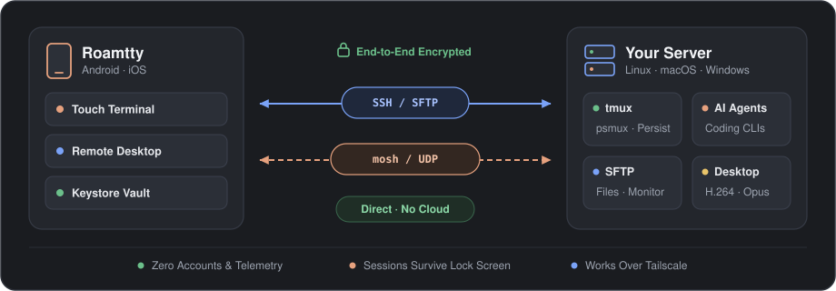
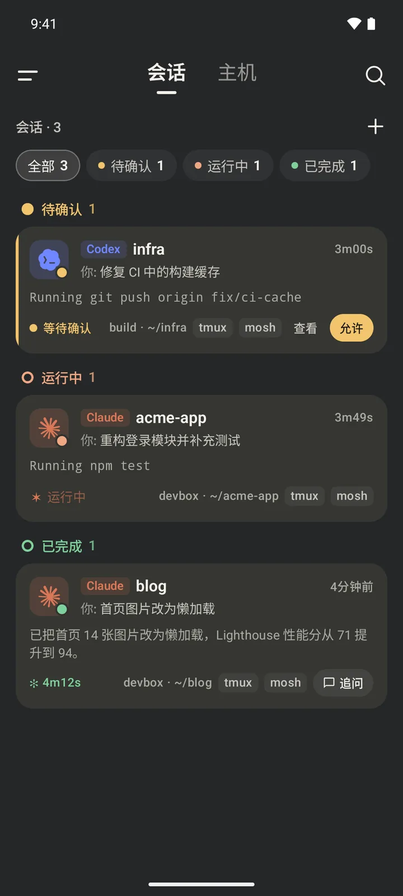
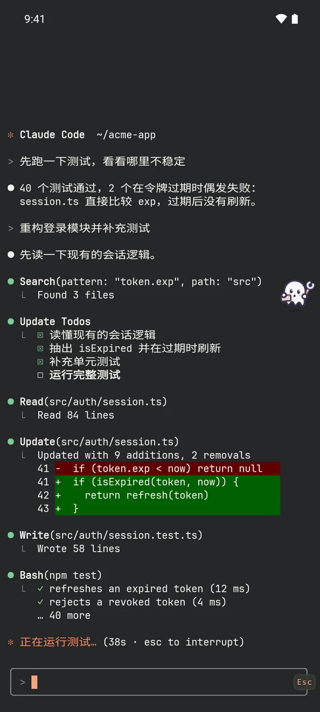
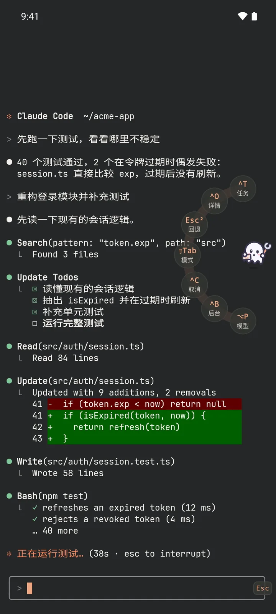
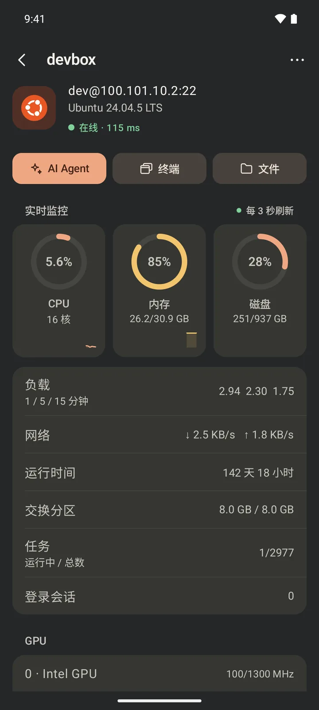

# Roamtty

[English](README.md) | **简体中文**

面向远程 AI 编程的 Android SSH、终端与远程桌面客户端，原生支持 `Claude Code`、`Codex`、`Grok`、`Antigravity`。

`Android 8.0+ (API 26)` · `Kotlin + Compose` · `com.roamtty.app` · [官网](https://roamtty.com/) · [iOS 版](https://github.com/yahaa/roamtty-ios) · [桌面插件](https://github.com/yahaa/roamtty-desktop)



<p align="center">
  
  
  
  
</p>

## 核心特性

- **主机与信任** — 支持密码、交互式认证及 OpenSSH/PEM 私钥（Ed25519、RSA，含加密私钥）。自动识别远端系统、在线状态与 TCP 建连延时；首次连接核对 SHA-256 指纹，指纹变化时强制拦截。
- **持久化会话** — 每台主机最多 8 个独立 `tmux`（POSIX）或 `psmux`（Windows）会话，锁屏断网后可无缝重附着；主机装有 `mosh` 时优先走 UDP（60000–61000），8 秒无回应自动回退 SSH，支持一键安装插件。
- **AI 编程 Agent** — 一键在指定目录启动 `Claude Code`、`Codex`、`Grok` 或 `Antigravity CLI`，支持计划 / 只读、普通与 YOLO 权限。会话卡片实时展示任务标题、状态（待确认 / 运行中 / 已完成）、正在执行的命令及通知提醒。
- **触控终端** — 手势完成 Tab 补全、粘贴、历史回滚、光标拖动、方向键与双指缩放。侧边小幽灵点按展开操作栏（上传下载、插入最多 9 张图片、远端 shell 历史、草稿编辑），长按弹出随前台程序变化的快捷键环。
- **远程桌面** — 首次点按自动安装 [`roamtty-desktop`](https://github.com/yahaa/roamtty-desktop)，支持 H.264 视频、Opus 音频、UDP + Reed-Solomon 纠错（3 秒自动回退 SSH）及仿 Mac 触控板手势（Linux X11 / wlroots Wayland、macOS 13+、Windows 10/11）。
- **文件、监控与端口预览** — SFTP 浏览与代码高亮 / Markdown / 图片预览、系统分享传图；实时查看 CPU / 内存 / 磁盘 / 网络 / GPU / 进程；通过 SSH 隧道直接预览远端 `localhost` 开发服务。

> 本应用不自带模型，也不在手机上运行本地 Linux；所有工具运行在你自己的服务器上。不包含云同步、跳板机与通用端口转发界面。

## 隐私与安全

- **纯本地运行**：无账号、无广告、无统计分析、无遥测，不运营应用后端。
- **硬件密钥库加密**：保存的密码和私钥由不可导出的 Android Keystore 密钥以 AES-256-GCM 加密（AAD 绑定主机 ID 与字段用途）；私钥口令永不落盘。
- **最小持久化**：终端内容、编辑草稿和常用命令仅存于内存；关闭系统备份与设备迁移，禁止远端 OSC 52 改写剪贴板。
- 完整说明见 [隐私政策](docs/PRIVACY.md)（公开地址 [roamtty.com/privacy](https://roamtty.com/privacy/)）。

## 构建与测试

环境要求：**JDK 17**、**Android SDK 36** 与 **build-tools 36.0.0**（版本与校验见 `toolchains.lock.json`）。

```sh
# 构建 Debug 包并运行 Lint
./gradlew :app:assembleDebug :app:lint

# 运行全部 JVM 单元测试
./gradlew :app:testDebugUnitTest :ssh-core:test :desktop-core:test :code-core:test \
  :terminal-emulator:testDebugUnitTest :terminal-view:testDebugUnitTest
```

真机 / 模拟器测试、E2E 回归（`scripts/e2e/run.sh`）、Windows 夹具及发布签名见 [开发与测试指南](docs/DEVELOPMENT.md)。

## 文档导航

| 文档 | 说明 |
| --- | --- |
| [使用指南](docs/USER_GUIDE.zh-CN.md)（[English](docs/USER_GUIDE.md)） | 快速上手、AI Agent、终端手势、远程桌面、文件与常见问题 |
| [远程桌面手势规范](docs/desktop-gestures.md) | 触控 / 触控板手势表、阈值参数与真机验收命令 |
| [架构与设计约束](docs/ARCHITECTURE.md) | 模块分层、传输背压、安全信任、Agent Hooks 与 Termux 适配 |
| [开发与测试指南](docs/DEVELOPMENT.md) | 工具链、单元测试 / 设备测试 / E2E 回归与发布签名 |
| [Google Play 发布清单](docs/GOOGLE_PLAY_RELEASE.md) | 商店合规要求、前台服务声明与发布前检查 |
| [隐私政策](docs/PRIVACY.md) | 中英双语隐私政策（应用内与 roamtty.com 同步使用） |
| [第三方许可](THIRD_PARTY_NOTICES.md) | 第三方组件、字体与图标许可声明 |

## 许可证

本版本自有代码采用 [PolyForm Shield License 1.0.0](LICENSE)。代码可查看并在许可范围内使用和修改，但不得用于提供与 Roamtty 竞争的产品或服务（免费竞品同样受限制）。这是源码可见许可，不属于 OSI 定义的开源许可。

第三方组件保留各自许可（见 [THIRD_PARTY_NOTICES.md](THIRD_PARTY_NOTICES.md)）。历史版本已授予的 Apache-2.0 权利不受影响。详见 [NOTICE](NOTICE)。
