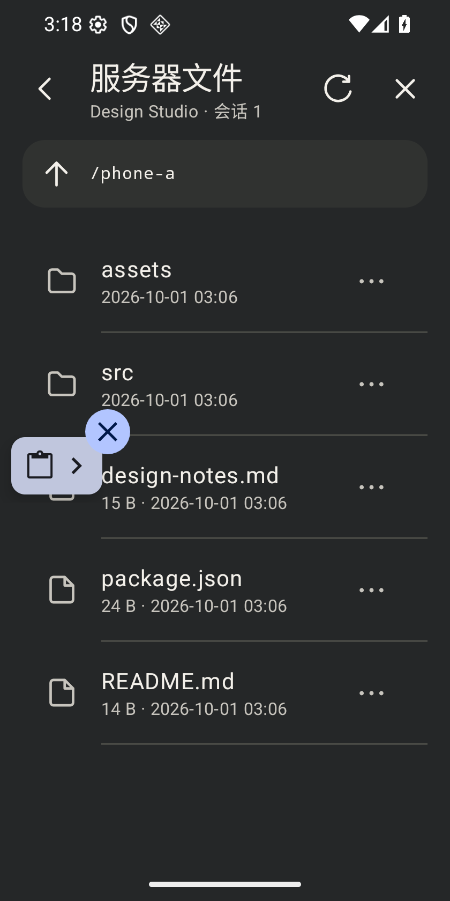
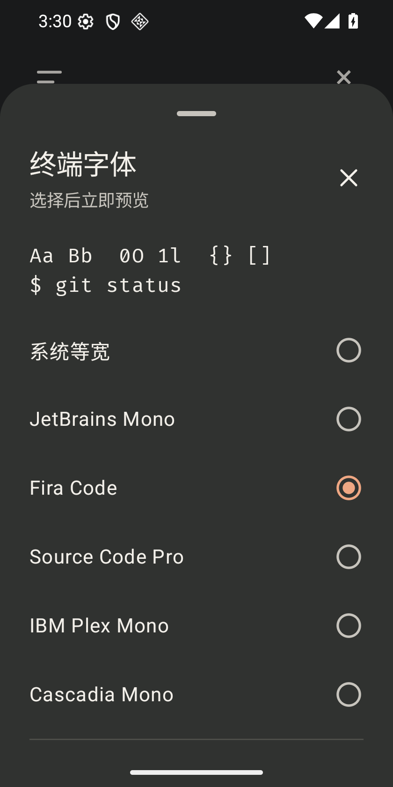
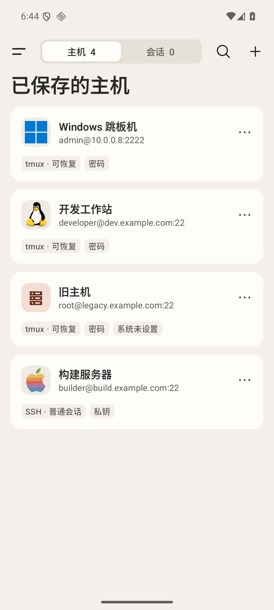
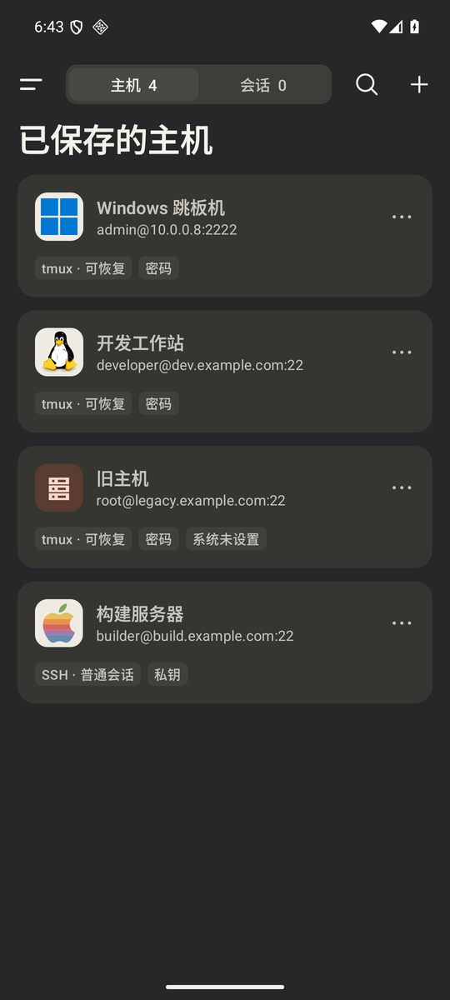
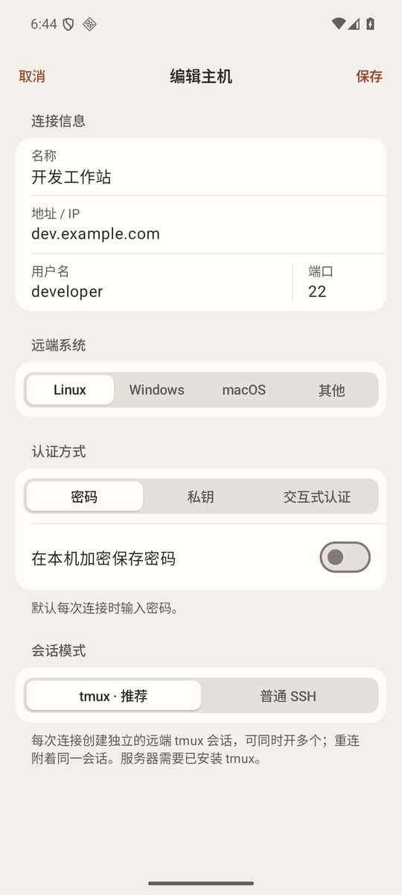
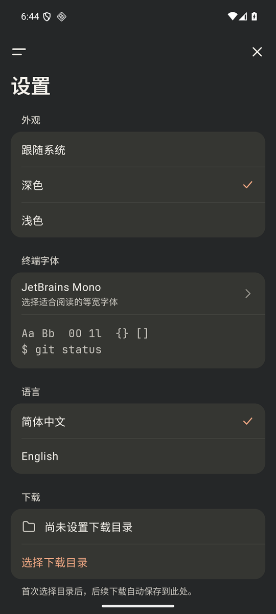

# 横竖屏布局评估（Apple Design 原则）

本应用运行在 Android 上。这里借用 Apple Human Interface Guidelines 的布局原则评估信息层级、可触达性、方向适配与状态连续性，不将 Android 界面伪装成 iOS 控件。

| 页面 | 竖屏评估 | 横屏发现与调整 |
| --- | --- | --- |
| 主机与会话 | 标题、切换入口、主要操作的层级清楚；保留单列阅读与自适应网格。 | 顶部与内容区重复占高，卡片过高，旋转后首行可能被截断。标题和操作收进同一工具栏，主机卡片改为紧凑排列，网格切换列数时对齐到卡片顶部。 |
| 主机编辑 | 单列字段适合窄屏；保持原有字段顺序。 | 全宽字段延长视线移动，认证与连接信息不易同时看到。宽屏改为连接/系统与认证/模式两列，选项可换行；旋转时保留未提交的字段和密钥导入状态。 |
| 终端 | 内容占据主要空间，底部快捷键保持原有布局。 | 单列侧栏需要滚动才能找到 Esc、Tab 等常用键；旋转时终端页面可能退回会话列表。足够高度且键盘收起时使用两列侧栏，并依据会话服务的真实状态保持当前终端。键盘展开或高度不足时使用可滚动单列。 |

按 [Layout](https://developer.apple.com/design/human-interface-guidelines/layout)、[Toolbars](https://developer.apple.com/design/human-interface-guidelines/toolbars)、[Segmented controls](https://developer.apple.com/design/human-interface-guidelines/segmented-controls) 和 [Accessibility](https://developer.apple.com/design/human-interface-guidelines/accessibility) 检查。实际实现保留 Android Compose 的组件、系统安全区域和输入法行为。

## 真机画面

PLU110 上拍摄：[竖屏编辑](screenshots/adaptive-editor-portrait-phone.png) · [横屏编辑](screenshots/adaptive-editor-landscape-phone.png) · [竖屏终端](screenshots/adaptive-terminal-portrait-phone.png) · [横屏终端](screenshots/adaptive-terminal-landscape-phone.png)。主机页横竖屏交互由下方导航测试覆盖。

## 验证

- `NavigationThemeTest`：竖屏/横屏主机、编辑草稿与密码跨旋转保留、主题和终端入口；PLU110 与模拟器各通过 1 次。
- `TerminalExtraKeysTest`：横屏快捷键可见及实际输入字节；PLU110 与模拟器各通过 1 次。
- 测试使用独立包名 `io.itermux.devicecheck`，没有覆盖手机上原有签名的应用。

测试输出：[真机导航](test-results/adaptive-navigation-phone.txt) · [真机终端](test-results/adaptive-terminal-phone.txt) · [模拟器导航](test-results/adaptive-navigation-emulator.txt) · [模拟器终端](test-results/adaptive-terminal-emulator.txt)。

## PR #6 设计修订（2026-10-01）

对比 `main` 与 PR 原版本 `6b2d426`，保留原有暖灰深浅主题、暖色强调色、16 dp 分组圆角、文字层级和线性图标。文件、命令和字体新增页面使用这些既有样式；选择任务放入底部面板，确认与破坏性操作保留对话框。

| 发现的问题 | 修订后的行为 |
| --- | --- |
| 历史命令显示不完整且点选立即执行 | 点选只将完整文本放入编辑区，用户检查后发送；不自动追加回车。 |
| 文件列表与设置页的信息密度过高 | 文件列表只展示名称、大小及时间，权限移入操作面板；字体设置展示当前字体与预览，点开再选择。 |
| 文件操作和命令列表借用警告弹窗 | 改为圆角底部面板，统一关闭、标题、留白与滚动行为。删除仍需明确确认。 |
| 应用深色主题与系统浅色主题不同时，面板状态栏图标对比不足 | 面板窗口的系统栏跟随应用配色，深色面板显示浅色状态栏图标。 |
| 7 个快捷键在 320 dp 窄屏溢出 | 快捷键分为两行，每项保持 48 dp 触控区；空间不足的操作栏可滚动。 |
| Shift 与箭头组合被输入法可见性变化清除 | Shift 状态保留到箭头发送；不为箭头组合强制弹出输入法。 |
| 同一主机多个会话难以区分 | 默认标题带独立编号；编号写入会话日志，重连保持。分享图片时多个连接必须明确选目标。 |
| 文件页自定义边缘手势与系统返回/抽屉冲突 | 工具栏返回与 Android 返回沿访问记录回退；上箭头单独进入父目录，关闭按钮返回主机列表。 |
| 旋转丢失目录、草稿或下载目标 | 会话持有文件浏览状态与操作任务；外部保存位置选择器保留待下载路径，列表保留各目录滚动位置。 |
| 文件“更多”按钮缺少读屏标签 | 增加带文件名的操作标签、文件类型及长按动作语义；操作进度/错误提供 live region。 |
| 递归删除缺少进度、取消和部分失败反馈 | 显示进行中状态与取消按钮；文件操作间检查取消，失败或取消后刷新目录并保留结果提示。 |
| 图片上传路径难以复用 | 结果支持选取、复制路径及放入编辑区；横屏大字号时结果内容可滚动。 |

这些选择依据 Apple HIG 的 [Layout](https://developer.apple.com/design/human-interface-guidelines/layout)、[Sheets](https://developer.apple.com/design/human-interface-guidelines/sheets)、[Alerts](https://developer.apple.com/design/human-interface-guidelines/alerts)、[Gestures](https://developer.apple.com/design/human-interface-guidelines/gestures)、[Accessibility](https://developer.apple.com/design/human-interface-guidelines/accessibility) 与 [Progress indicators](https://developer.apple.com/design/human-interface-guidelines/progress-indicators) 原则，落地仍使用 Android 原生返回、输入法与 Compose 无障碍语义。48 dp 是本项目的 Android 触控目标，不能与 Apple 的 pt 单位混用。

### 本轮验证范围

使用 API 36 模拟器，320 × 640 dp 及旋转后的 640 × 320 dp，系统字号 100% / 200%。所有 SSH/SFTP 输入均来自本地隔离夹具，截图中没有真实服务器内容。本节记录模拟器结果；上面的历史真机记录不代表本轮修订已经完成真机验收。

- JVM：app 29、SSH core 28、terminal emulator 150、terminal view 16 项通过，共 223 项；另有 28 项需要 OpenSSH 环境的集成测试跳过。
- 构建与 Android Lint 通过；Lint 保留原有 2 个 warning、1 个 hint，0 error。
- `DesignUiTest`：搜索恢复、完整命令选择、文件操作可触达/标签、字体即时预览、图片路径复制与放入编辑区；100% 竖屏、200% 竖屏和 200% 横屏均验证。
- `FileBrowserLifecycleTest`：SFTP 目录、重命名草稿及待下载路径经过 Activity 重建保持；返回沿访问路径回退。
- `SessionReconnectUiTest`：同主机编号区分、日志实际读写、重连沿用编号与终端绑定。
- `TerminalExtraKeysTest`：7 个快捷键的 48 dp 触控区、实际 SSH 按键字节、Shift+Left、横屏输入法、常用命令只进入编辑区。原测试以屏幕高度 20% 抓取滚动条，在原 PR 上也会错过已淡出的滑块；改为抓取已滚到顶部的可见滑块后验证返回实时输出。

记录：[构建/单元测试](test-results/pr6-design-build.txt) · [终端单元测试](test-results/pr6-design-terminal-unit.txt) · [常规界面](test-results/pr6-design-ui.txt) · [终端界面](test-results/pr6-design-terminal-ui.txt) · [200% 竖屏](test-results/pr6-design-200-portrait.txt) · [200% 横屏](test-results/pr6-design-200-landscape.txt)。

待补充的验证：真实手机上的 TalkBack 全流程、不同厂商输入法、长时间网络中断及大量远端文件删除。当前结果支持设计原则与已覆盖交互的一致性，不代表 Apple 官方认证或所有设备上的验收。

### 修订后画面

## 统一设计系统（2026-10-03）

以 `main`（ac712f8）为基础，把各页面零散的字号、圆角、按钮和文字符号收拢到一套规则里。暖灰底色与暖色强调色保持不变；组件仍是 Compose Material 3，只借用 Apple HIG 的信息层级与控件语义。

| 规则 | 落地 |
| --- | --- |
| 每页一个大标题，操作放进工具栏 | 主机/会话页：工具栏为「导航 · 分段控件 · 搜索 · 添加」，下方大标题；横屏省去大标题，只保留工具栏。设置页保留导航按钮，右侧关闭按钮换成矢量图标。 |
| 并列视图用分段控件 | 主机/会话切换、主机编辑中的系统、认证、会话模式都改为带滑块的 `SegmentedControl`，选中项有 Tab 语义。 |
| 设置与表单用嵌入式分组 | `GroupedSection`：标题在上、说明在下，行间分隔线缩进到文字列；单选项用尾部勾号，开关用 Switch，跳转行带箭头。 |
| 图标而不是文字符号 | `•••`、`✎`、`×`、`＋ 主机`、`连接 →` 换成同一描边风格的矢量图标（新增 add/edit/delete/clear）。 |
| 状态不只靠颜色 | `StatusLabel` 用圆点加文字表示连接状态，成功/进行中/失败各有深浅两套色值。 |
| 字号不低于 12 sp | `AppTypography`：大标题 30、行标题 16 半粗、说明 13；去掉卡片里 11 sp 的彩色元信息，改为中性的小标签。 |
| 一套圆角 | 输入框/菜单 10、行 12、卡片与分组 16、浮层 20、对话框与底部面板 28，页面不再自定圆角。 |
| 一种搜索框 | 主机、会话、常用命令、目录筛选、文件内查找共用填充式 `AppSearchField`，清除按钮是图标。 |

浅色主题底色从 `#F7F5F1` 调为 `#F3F0EB`，让白色分组面板与页面分开；终端浅色背景同步调整，终端区域与界面底色保持一致。主机编辑页改为无边框全屏对话框，状态栏跟随页面配色。

