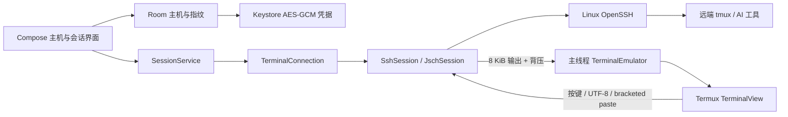

# 架构与设计约束

## 数据与线程

`ssh-core` 是可在 JVM 上独立测试的 Kotlin 模块。Target、Credentials、PinStore、Prompt 和 SshSession 与 Android 无关。mwiede/JSch 负责 SSH 协议与认证，不自制密码学。Bouncy Castle 为 Android 提供现代密钥算法支持，保留 JSch 的算法默认策略，不自动启用 ssh-rsa/SHA-1 等旧算法。

`JschSession.connect` 在 IO dispatcher 执行握手和读取。输出按最多 8192 字节逐段交给挂起回调，回调等待主线程完成解析后才读下一段，因此 UI 慢时不会积压无界输出。所有终端 append、resize、paste、按键生成和绘制均在主线程串行执行。历史上限 5000 行；每个终端有独立的解析器和缓冲区。

输入有界队列容量 64，单次原始写入上限 256 KiB，编辑/粘贴上限 128 KiB。断开关闭队列并清空剩余数据；每次重连创建新的 transport 和终端，不重放旧输入。PTY resize 使用合并队列，只发送最新尺寸，网络写入不阻塞 UI。SSH keepalive 间隔 15 秒，最多 3 次未响应后断开。

## 信任与凭据

主机指纹按规范化后的 `[hostname]:port` 存储，IPv6 地址统一去掉输入方括号后再规范化。首次未知指纹需用户确认；已知地址收到不同公钥立即失败，既不会降级也不会使用通用“忽略主机密钥”开关。首次确认的写入在 Room 事务中采用 insert-if-absent，防止两个并行首次连接互相覆盖。重新核验是单独的显式操作，会关闭同地址连接并清除原信任记录，再重连核验。

Keystore 持有不可导出的 AES 密钥，AES-GCM 随机 IV 和 128 位认证标签保护本地凭据。AAD 包含主机 ID 与 `password` / `key` 用途，避免密文跨主机或跨字段置换。凭据与主机同一 Room 行保存；删除主机同时移除密文。备份、设备迁移、凭据日志、终端日志、遥测都关闭。密钥口令不落盘。不可变的 JVM/Compose 字符串不能保证立即擦除，但不会持久化，字节数组在认证完成或取消时清零。

交互式认证通过 StateFlow 暴露待回答问题，答复使用 CompletableDeferred。连接取消会同时解除等待。等待用户输入上限 120 秒；网络握手/通道建立超时 20 秒。UI 不把服务器错误字符串或库堆栈写入日志。

## 生命周期

终端根布局仅应用 `WindowInsets.captionBar` 和输入法边距。摄像头的 `displayCutout` 不再作用于整个终端，避免隐藏状态栏后仍留下整条顶部或侧边空白；悬浮操作按钮单独避让开孔，固定侧栏仅在栏内避让顶部/底部开孔。主机列表仍使用 `safeDrawing`，保持系统栏和标题内容分开。

连接页默认全屏，右侧操作栏默认隐藏，点击右上角 ⋯ 展开；显式固定的偏好仍保留。横竖屏按钮均沿终端滚动条方向竖排。仅显式固定时预留 48 dp 侧栏，输入法开关不改变操作栏位置；编辑框打开时暂时隐藏操作栏，关闭后恢复。快捷键面板及其 Ctrl 锁定状态已移除。默认隐藏输入法，轻触终端获取焦点并打开输入法。键盘按钮在点击时读取原生窗口的 IME 可见状态，通过 `SoftwareKeyboardControllerCompat` 控制原生终端输入；隐藏前先清除 Compose 和终端焦点。界面使用 `WindowInsets.isImeVisible` 跟随键盘状态。从更多菜单打开“编辑文本”，点击编辑框输入；编辑框中的文字先进入草稿，只有“发送文本”才写入 SSH，回车独立发送。

用户主动打开连接时启动 `specialUse` 前台服务，并立即提供通知。Activity 只绑定服务和订阅 StateFlow，旋转和切换会话不负责维护底层 socket。关闭最后一个活动连接后停止前台状态并调用 stopSelf；若 Activity 仍绑定服务，可继续查看已断开的终端内容。服务使用 START_NOT_STICKY，不在系统重启后静默重连。

tmux 模式先运行只读的 `command -v tmux` 检查，再在带 PTY 的 exec channel 执行固定命令 `exec tmux new-session -A -s 'itermux'`。普通 SSH 使用 shell channel。没有远端安装、端口转发、SFTP、文件同步或后台自动命令重放。

## 上游适配

输入法长按兼容：`ImeBackspaceTracker` 按接收时间识别间隔不超过 250 ms、持续 1000 ms 的退格流，清空后抑制同次长按的剩余退格。新的文字输入、方向键、重新建立输入连接或退格间隔中断会重置。入口覆盖 `sendKeyEvent`、`deleteSurroundingText` 和码点版本，操作栏和硬件键盘不参与推断。微信输入法不提供有效 repeatCount/downTime，快速连续点按可能触发相同规则。

`InputConnection` 使用实际光标所在逻辑行（向前包含自动折行，最多八个屏幕行）或正在组合的文本响应 extracted/surrounding text 查询，保留 UTF-16 选区与空格，不返回整个历史，也不伪造占位文字。提供该上下文后微信输入法才能持续发送长按退格。[Android InputConnection 接口](https://developer.android.com/reference/android/view/inputmethod/InputConnection)。

输入控件：草稿以 `TextFieldValue` 保存选区，ICU `BreakIterator` 按字素边界移动和删除，内容仍只存于 `TerminalConnection.draft` 内存。终端方向键与退格经 `KeyHandler` 生成，与远端普通/应用光标模式一致；长按清空发送 Ctrl+U、Ctrl+K，不调用 emulator reset，也不清除滚动历史。

`TranscriptScrollBar` 在 `TerminalView` 内绘制本地历史位置，6 dp 宽、24 dp 触摸区域，拖动直接映射到历史行。闲置 1200 ms 后用 250 ms 淡出，不预留终端宽度；悬浮操作栏距右边 24 dp 避开拖动区域。历史阅读时按 parser 的 scroll counter 平移 topRow，保留原内容位置；继续键入恢复到底部。无本地历史（含全屏程序的备用屏幕）不显示滚动条，原有远端鼠标/备用屏幕滚动处理不变。

固定 Termux commit：`4584488513c099f2e98bcfcd00f006d213248729`。只复制明确声明 Apache-2.0 例外的 terminal-emulator 和 terminal-view。TerminalSession 被改为接口，删除了 JNI/local-process 实现，不需要安装 Termux。IME 配置改成真正的文本输入类型；组合阶段只改本地 Editable，commit 才写入终端；组合输入期间的删除不回传远端。远端 OSC 52 不可写 Android 剪贴板，用户选择复制仍可用。粘贴的 bracketed 起止序列和内容以一次写入入队。

应用窗口默认禁止系统截图与最近任务快照。测试仅在测试 Activity 中临时关闭该标志，截图内容均来自专用测试环境。
