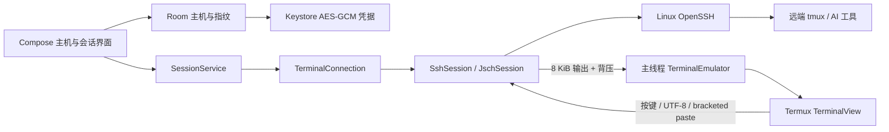

# 架构与设计约束

## 数据与线程

`ssh-core` 是可在 JVM 上独立测试的 Kotlin 模块。Target、Credentials、PinStore、Prompt 和 SshSession 与 Android 无关。mwiede/JSch 负责 SSH 协议与认证，不自制密码学。Bouncy Castle 为 Android 提供现代密钥算法支持，保留 JSch 的算法默认策略，不自动启用 ssh-rsa/SHA-1 等旧算法。

`JschSession` 管理认证、传输、重连与 PTY，保留原有文件操作入口并委托给内部 `SftpOperations`。后者通过回调取得当前活动连接，独立管理短生命周期 SFTP 通道、字面路径、传输、目录操作及清理；不会持有跨重连的旧 SSH 连接。远端文件模型、路径与显示格式函数集中在 `RemoteFiles.kt`。JSch 的通配操作使用转义路径，`realpath` 使用原始路径。

下载队列内部更新单项数据，仅在节流发布或状态转换时复制列表，保证 UI 收到的历史快照不会被后续进度修改。重名分配预留所有原始文件名，并按不区分大小写的名称记录下一候选编号，保持原有扩展名和冲突处理规则。shell 历史的来源选择、截断处理与排序集中在 `ShellHistoryCommands.kt`，通过注入读取函数独立测试，终端连接只负责触发加载及发送输入。

`JschSession.connect` 在 IO dispatcher 执行握手和读取。输出按最多 8192 字节逐段交给挂起回调，回调等待主线程完成解析后才读下一段，因此 UI 慢时不会积压无界输出。所有终端 append、resize、paste、按键生成和绘制均在主线程串行执行。本地回滚上限 10,000 行；每个终端有独立的解析器和缓冲区。

输入有界队列容量 64，单次原始写入上限 256 KiB，编辑/粘贴上限 128 KiB。断开关闭队列并清空剩余数据；自动重连创建新的 transport 和输入队列，不重放旧输入。PTY resize 使用合并队列，只发送最新尺寸，网络写入不阻塞 UI。SSH keepalive 间隔配置为 15 秒，`serverAliveCountMax` 为 4；约一分钟的静默可能触发断开，实际时间还取决于传输状态和 JSch 的超时处理。

启动目录与 agent 命令等待当前连接进入就绪状态，并绑定该次输入 writer 的代次；等待输出稳定期间若连接或代次变化，会重新等待。仅在明确未入本地队列时重试，成功入队后不会跨重连重放；入队成功不代表远端已执行。用户主动断开会取消等待中的启动命令。网络变化时 SSH 探活通过打开一个不启动 shell、也不执行命令的 session channel 获取往返回复；真实的 `SSH_OPEN_FAILURE` reason 表明服务器仍有回应，socket 写入失败或未收到回复则关闭旧 transport，不按异常返回速度猜测存活。

## 信任与凭据

服务器信任记录按规范化后的 `[hostname]:port` 存储算法和公钥，指纹由公钥计算；IPv6 地址统一去掉输入方括号后再规范化。首次未知指纹需用户确认；已知地址收到不同公钥立即失败，既不会降级也不会使用通用“忽略主机密钥”开关。首次确认的写入在 Room 事务中采用 insert-if-absent，防止两个并行首次连接互相覆盖。同地址和端口的主机共享信任记录；删除主机配置不撤销该记录。重新核验是单独的显式操作，会关闭同地址连接并清除原信任记录，再重连核验。

Keystore 持有不可导出的 AES 密钥，AES-GCM 随机 IV 和 128 位认证标签保护本地凭据。AAD 包含主机 ID 与 `password` / `key` 用途，避免密文跨主机或跨字段置换。凭据与主机同一 Room 行保存；删除主机同时移除密文。备份、设备迁移、凭据日志、终端日志、遥测都关闭。密钥口令不落盘。不可变的 JVM/Compose 字符串不能保证立即擦除，但不会持久化，字节数组在认证完成或取消时清零。

交互式认证通过 StateFlow 暴露待回答问题，答复使用 CompletableDeferred。连接取消会同时解除等待。等待用户输入上限 120 秒；网络握手/通道建立超时 20 秒。UI 不把服务器错误字符串或库堆栈写入日志。

## 生命周期

用户主动打开连接时启动 `specialUse` 前台服务，并立即提供通知。Activity 只绑定服务和订阅 StateFlow，旋转和切换会话不负责维护底层 socket。关闭最后一个活动连接后停止前台状态并调用 stopSelf；若 Activity 仍绑定服务，可继续查看已断开的终端内容。服务使用 START_NOT_STICKY，不在系统重启后静默重连。

`SessionJournal` 每台主机最多保存 8 条会话的 ID、Room 主机 ID、模式、标题、远端 tmux 会话名和会话序号。服务重新创建时读取对应主机并创建无凭据、无连接任务的已断开条目；已删除主机的记录不恢复。新建连接等待恢复完成，避免覆盖已有列表。断开保留记录。关闭已连接的 tmux 会话会先在服务器上结束该 tmux 会话再移除卡片；连不上时保留卡片，之后可另行登录结束远端会话（`terminate()`）或直接移除（`forget()`）。普通 shell 关闭即移除条目。终端输出、输入队列和编辑草稿不会写盘。常用命令保存在会话内存中，断开后可继续查看，不写入会话日志，进程结束后不保留。

活动连接持有 `PARTIAL_WAKE_LOCK`，所有连接非活动或服务销毁时释放。锁的寿命与用户打开的连接一致，没有会导致长连接再次休眠的固定到期时间。前台服务与唤醒锁仍受深度 Doze 限制；设置页提供系统电池优化管理入口，由用户选择豁免，不申请自动豁免权限。[Android 唤醒锁](https://developer.android.com/develop/background-work/background-tasks/awake/wakelock)、[Doze 限制](https://developer.android.com/training/monitoring-device-state/doze-standby)。

`FileTransferController` 由 `TerminalConnection` 持有，使用服务作用域与 StateFlow 管理任务/进度，Activity 只展示状态。SAF 下载失败或取消在 `NonCancellable + IO` 中删除文档；文档 URI 使用 `DocumentsContract.deleteDocument`，删除失败显式反馈。SFTP 操作统一转义字面路径中的 `\`、`*`、`?`（JSch `realpath` 例外，接受原始路径）；上传使用同目录固定长度随机临时文件名，避免合法目标文件名因追加后缀超长。

tmux 模式先运行只读的 `command -v tmux` 检查，再在带 PTY 的 exec channel 附着经校验的独立会话名 `roamtty-<id>`。附着前仅取消该窗格遗留的 copy-mode；`tmux new-session -A -D -s <会话名>` 创建或附着会话，并断开旧客户端，保留会话内的远端任务。会话开启 tmux 鼠标模式并关闭状态栏：上下滑动以滚轮事件交给 tmux 滚动它自己的历史，单击、双击、三击不作为鼠标点击发送，以免被 tmux 当成选词选行。普通 SSH 使用 shell channel。文件传输使用相同已认证 SSH 连接上的独立 SFTP channel，Android SAF 提供手机侧输入输出流；上传先写远端临时文件，确认目标不存在后改名。下载统计成功写入目标流的实际字节数；普通文件显式提供正数大小时，EOF 后核对是否一致，长度变化或下载不完整会失败并按现有 SAF 清理流程删除本地半成品。特殊文件、缺少大小属性或 stat 大小为零的动态流以未知总量显示，不用声明大小覆盖实际进度。连接时不会自动安装远端软件；用户在主机菜单显式点击安装后，`HostPluginInstaller` 可通过远端包管理器安装 tmux / mosh。从应用启动 Claude Code、Codex 或 Grok（POSIX 主机）时，才会通过 exec channel 把 `~/.roamtty/agent-hook.sh` 和该 agent 的 hook 文件写入远端：Claude Code 用 `claude-hooks.json`，以 `--settings` 附加到 claude 命令（与用户自己的设置合并，不改动用户配置）；Codex 与 Grok 改为输入启动器 `~/.roamtty/codex` / `~/.roamtty/grok`（带原有参数）。Codex 启动器用 `-c hooks.<事件>=…` 加入 hooks，并在 `${CODEX_HOME:-~/.codex}/config.toml` 追加这些 hook 的 `hooks.state."/<session-flags>/config.toml:<事件>:0:0".trusted_hash`，即 Codex 自己“Trust all”会写入的同一哈希（规范化定义的有序 JSON 的 SHA-256），已有同名条目则不动；哈希方案若随版本变化，Codex 会照常请用户审阅一次。`-c` 让 Codex 以内嵌模式运行（不用共享后台服务），hook 因而继承窗格的 `$TMUX_PANE`。Grok 没有按次加载 hooks 的参数，启动器把 `roamtty.json` 写入 `${GROK_HOME:-~/.grok}/hooks`（全局 hooks 无需信任），并以 `ROAMTTY_AGENT=grok` 运行 grok；脚本只在该变量存在时记录，用户自己启动的 Grok 不受影响，Grok 子 agent 的事件也被忽略。启动器在 agent 退出后执行 end 清除状态，并以 agent 的退出码退出；因为窗格前台此时是 `/bin/sh` 启动器，状态读取不再把 `sh` 当作“已回到 shell”。重启窗格时从 `ps` 读回的是启动器命令行，会再次经启动器启动。hook 把状态、当前工具和任务写入该 tmux 会话的 `@roamtty_agent` / `@roamtty_task` 选项（Grok 的 camelCase 字段同样读取；等待授权时保留即将运行的工具与命令）；应用每 3–10 秒用一条 `tmux display-message` 读取，在会话列表显示“运行中 / 等待确认 / 空闲”。窗格已回到 shell 时忽略遗留状态。没有端口转发、文件同步或后台自动命令重放。

## 上游适配

输入法长按兼容：`ImeBackspaceTracker` 按接收时间识别间隔不超过 150 ms、持续 1000 ms 的退格流，清空后抑制同次长按的剩余退格。新的文字输入、方向键、重新建立输入连接或退格间隔中断会重置。入口覆盖 `sendKeyEvent`、`deleteSurroundingText` 和码点版本，操作栏和硬件键盘不参与推断。微信输入法不提供有效 repeatCount/downTime，快速连续点按可能触发相同规则。

`InputConnection` 使用本地 Editable 中非空的组合文本响应 extracted/surrounding text 查询，保留 UTF-16 选区与空格；没有组合文本时返回空字符串及零选区。不读取远端光标所在逻辑行，不返回终端历史，也不伪造占位文字。[Android InputConnection 接口](https://developer.android.com/reference/android/view/inputmethod/InputConnection)。

输入控件：草稿以 `TextFieldValue` 保存选区，ICU `BreakIterator` 按字素边界移动和删除，内容仍只存于 `TerminalConnection.draft` 内存。终端方向键与退格经 `KeyHandler` 生成，与远端普通/应用光标模式一致；长按清空发送 Ctrl+U、Ctrl+K，不调用 emulator reset，也不清除滚动历史。

终端不绘制滚动条。普通 SSH 上下拖动映射本地 topRow；应用创建的 tmux 会话由 tmux 鼠标模式自行滚动。本地历史阅读时按 parser 的 scroll counter 平移 topRow，保留原内容位置；继续键入恢复到底部。

固定 Termux commit：`4584488513c099f2e98bcfcd00f006d213248729`。只复制明确声明 Apache-2.0 例外的 terminal-emulator 和 terminal-view。TerminalSession 被改为接口，删除了 JNI/local-process 实现，不需要安装 Termux。IME 配置改成真正的文本输入类型；组合阶段只改本地 Editable，commit 才写入终端；组合输入期间的删除不回传远端。远端 OSC 52 不可写 Android 剪贴板，用户选择复制仍可用。粘贴的 bracketed 起止序列和内容以一次写入入队。

应用窗口允许系统截图，并遵循系统正常的最近任务预览行为，不设置 `FLAG_SECURE`。测试截图内容均来自专用测试环境。
