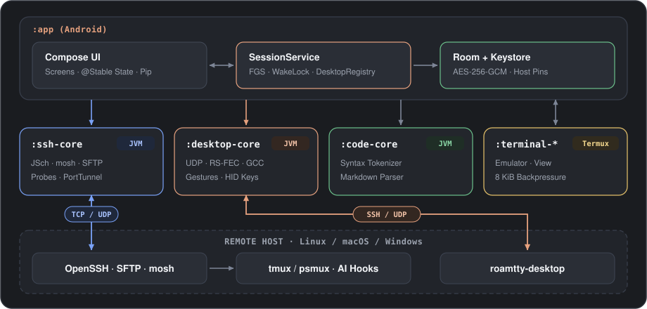

# Architecture & Design Constraints



## Modules & Layering

| Module | Platform | Responsibility |
| --- | --- | --- |
| `:app` | Android | Compose UI, `SessionService`, Room/Keystore, `MediaCodec` desktop player |
| `:ssh-core` | Pure JVM | SSH/mosh transport (`mwiede/JSch`), SFTP, loopback `PortTunnel`, probes & plugin installers |
| `:desktop-core` | Pure JVM | Desktop wire protocol, UDP/RS-FEC/GCC link, `DesktopGestures`, HID keymaps, plugin manifest |
| `:code-core` | Pure JVM | Syntax tokenizer (`CodeTokenizer`) & Markdown parser for file previews |
| `:terminal-emulator` / `:terminal-view` | Android | Pinned Apache-2.0 Termux terminal core & view (no JNI / local process) |

Pure JVM modules have zero Android dependencies and run directly on JVM unit tests. Within `:app`, packages depend strictly downward:

```text
io.itermux.app          AppLocale/EnglishText, AppSettings, fonts, ItermuxApp, MainActivity
  ├── data              Room hosts & pins, SecretVault, HostCredentials, RecentUsage
  ├── login             PendingPrompt, pageLogin (reusable SSH login flow)
  ├── session / desktop TerminalConnection & DesktopConnection (owned only by SessionService)
  └── ui                Compose screens (the only package importing all layers below)
```

- `session` never imports `ui`; `data` never imports `ItermuxApp`; `desktop` logs in via `login` and never imports `session`.
- Large screens follow a single pattern: one `@Stable` state holder (e.g. `TerminalPaneState`, `ScreenState`) + thin layout/component files (`TerminalPane*.kt`, `RemoteFileBrowser*.kt`, `Desktop*.kt`).
- `ItermuxScreen` is a pure assembler (`ScreenData`, `ScreenEffects`, `ScreenActions`, `ScreenPages`, `ScreenDialogs`).

## Transport, Threading & Limits

| Parameter | Value / Rule |
| --- | --- |
| Output read chunk | ≤ 8 KiB on `Dispatchers.IO`; suspends until main thread parses (backpressure) |
| Terminal emulation & draw | Serialized on main thread; per-terminal emulator & 10,000-line scrollback |
| Input queue | Bounded (64 items); raw write ≤ 256 KiB; draft / paste ≤ 128 KiB |
| PTY resize | Coalesced queue; sends latest dimensions off the UI thread |
| SSH keepalive | 15 s interval × 4 (`serverAliveCountMax`); connect timeout 20 s; auth prompt 120 s |
| Network probe | Opens an empty session channel on network change; closes stale transport on write error / timeout |
| `mosh` fallback | Prefers UDP (60000–61000); falls back to SSH after 8 s without response |
| Sessions per host | Max 8 persisted in `SessionJournal` (`DesktopConnection` does not consume quota) |

- **SFTP & Downloads**: `SftpOperations` opens short-lived SFTP channels from the active session (never holds stale transports across reconnects), escapes `\`, `*`, `?` on globbed calls (raw paths for `realpath`), uploads via random temp names + atomic rename, and verifies EOF byte count for regular files (deleting incomplete Android SAF files on failure/cancel).
- **Startup commands**: `AgentLaunch` / start directory waits for connection readiness bound to the input writer generation; retries only if never enqueued locally and never replays across reconnects.
- **Disconnects**: Closing or reconnecting clears the input queue and creates a fresh transport without replaying stale input.

## Security & Trust

- **Host Key Pinning (TOFU)**: Stored by normalized `[hostname]:port` (algorithm + public key; IPv6 brackets normalized). First trust uses `insert-if-absent` inside a Room transaction. Mismatched keys fail immediately with no "ignore host key" bypass. Host deletion preserves pins; **Verify again** explicitly disconnects matching hosts, clears the pin, and re-verifies.
- **Credentials**: Non-exportable Android Keystore AES key with AES-256-GCM (random IV, 128-bit tag). AAD binds `hostId` + field purpose (`password` / `key`) to prevent cross-host or cross-field substitution. Stored in the host's Room row and deleted with the host. Key passphrases never touch disk; byte arrays are zeroed after auth.
- **Hardening**: `allowBackup=false`, `usesCleartextTraffic=false`, zero telemetry/analytics SDKs, remote OSC 52 clipboard writes blocked, server errors and stack traces excluded from logs.

## Sessions, AI Hooks & Foreground Service

- **Foreground Service**: Active sessions or remote desktop start a `specialUse` foreground service (`START_NOT_STICKY`) holding a `PARTIAL_WAKE_LOCK` until the last connection closes. Activities bind and observe `StateFlow`.
- **`SessionJournal`**: Stores up to 8 entries/host (ID, host ID, mode, title, remote tmux name, index) — never terminal output, drafts, or shell history. Closing a connected `tmux` session terminates it remotely first; unreachable cards stay until terminated or forgotten.
- **tmux / psmux**: Runs read-only `command -v tmux`, cancels stale `copy-mode`, attaches `tmux new-session -A -D -s roamtty-<id>` with mouse wheel scrolling enabled and status bar off.
- **AI Agent Hooks** (POSIX hosts, written only when launched from Roamtty):
  - Installs `~/.roamtty/agent-hook.sh` plus agent config: Claude Code uses `--settings ~/.roamtty/claude-hooks.json`; Codex, Grok, and Antigravity use wrappers (`~/.roamtty/{codex,grok,agy}`).
  - Hooks write status, tool/command, and task preview into tmux session options (`@roamtty_agent`, `@roamtty_task`), cleared on agent exit; Roamtty polls via `tmux display-message` every 3–10 s.
  - Codex launcher runs embedded mode (`-c hooks.<event>=...`) with matching trusted hashes in `config.toml`; Grok (`~/.grok/hooks/roamtty.json`) and Antigravity (`~/.gemini/config/plugins/roamtty`) gate reporting on `ROAMTTY_AGENT`.

## Remote Desktop Pipeline

- **Host Plugin**: Single binary from [`yahaa/roamtty-desktop`](https://github.com/yahaa/roamtty-desktop), version & per-target SHA-256 pinned in `assets/desktop-plugin.json` (`scripts/desktop/pin.sh`). Protocol goldens live in `desktop-core/src/test/resources/desktop-proto/`.
- **Install**: Host downloads directly; on failure, phone downloads and uploads over SFTP → SHA-256 verify → atomic rename.
- **Media**: `DesktopConnection` runs `roamtty-desktop serve`, feeds H.264 frames to `MediaCodec` directly onto a `SurfaceView` (ACK after decode), and plays 48 kHz stereo Opus audio (`AudioPlayer`). Leaving the page sends `PAUSE`; reconnect uses `--resume` (30 s window).
- **UDP Link**: `hello` exchanges port + ephemeral key. Datagrams use plaintext `dir | seq` + AES-128-GCM, chunked with GF(2⁸) Cauchy Reed-Solomon FEC (5–30% adaptive). Reliable messages (keys, buttons, text, control) retransmit until RACK; pointer/wheel/ping send once. Simplified GCC + 1.5× pacing + NACK when RTT < 2 frames. 3 s silence falls back to SSH; network change opens a new socket and roams immediately.
- **Host Backends**: Linux X11 (MIT-SHM / XFIXES / XTEST), wlroots Wayland (`wlr-screencopy` / virtual pointer & keyboard), macOS 13+ (notarized LaunchAgent `.app`: ScreenCaptureKit / VideoToolbox / CGEvent), Windows 10/11 (DXGI / Media Foundation or OpenH264 / SendInput via logon task or SYSTEM service). GNOME/KDE Wayland (`xdg-desktop-portal`) is not yet implemented.

## Upstream Termux & IME Adaptation

- **Pinned commit**: Termux `4584488513c099f2e98bcfcd00f006d213248729` (Apache-2.0 exception files of `terminal-emulator` and `terminal-view` only; `TerminalSession` converted to an interface; JNI/local-process removed).
- **IME composition**: Real text input type; composing edits stay in local `Editable` and only committed text writes to SSH. `InputConnection` exposes only active composing text (never terminal history).
- **Line clear**: `ImeBackspaceTracker` detects sustained backspace streams (≤ 150 ms gap for 1000 ms) and sends `Ctrl+U` / `Ctrl+K` without clearing scrollback.
- **Draft & Scrolling**: Drafts keep `TextFieldValue` selection with ICU `BreakIterator` grapheme movement. No scrollbars; plain SSH scrolls local `topRow` (stable via parser scroll counter), while tmux delegates scroll wheel events to tmux.
- **Screenshots**: `FLAG_SECURE` is intentionally not set.
