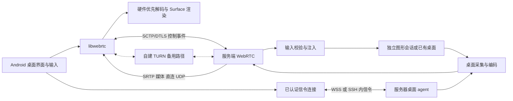

# 低延时远程桌面调研与 WebRTC 接入方案

调研日期：2026-10-05 至 2026-10-06。状态：待 PoC 验证的技术提案。仓库基线：`b04bce2`。本文只增加调研与设计，尚未实现远程桌面，也没有在目标服务器和 Android 真机上测得延时。

## 1. 建议结论

**以 WebRTC 为主线：先用 Selkies 的 WebRTC 模式完成端到端验证，再评估 Roamtty 原生 Android 客户端对接。** 首期针对 Linux 单用户桌面，覆盖触摸模拟鼠标、外接鼠标键盘和中文输入。无 GPU 服务器从 720p/30 fps 软件编码起步，有 GPU 的服务器验证 1080p/60 fps 硬件编码；这些是测试档位，不是性能承诺。

WebRTC 提供实时媒体、DataChannel、连接协商和网络适应能力，**不直接提供服务器桌面、屏幕采集、输入注入或用户鉴权**。完整方案必须有服务器侧桌面服务，以及采集、编码、输入代理。只有 SSH 的无头服务器，不能安装一个 Android 播放器就获得图形桌面。

建议分两步选择实现：

1. **验证阶段选 Selkies**：复用它的桌面采集、编码、WebRTC 和输入实现，用官方网页客户端建立性能基线；同时做一个 Android 接收与输入互通的小原型。
2. **产品阶段按验证结果决定**：互通、输入、性能和升级成本通过验收后，用原生 libwebrtc 接入 Selkies；若其应用协议或部署依赖不合适，再评估自有 Linux agent + GStreamer `webrtcbin`。不要一开始同时维护两套服务端。

这一选择是结合本仓库约束的工程判断，不是已证明 WebRTC 在所有网络、硬件上都最快。RDP/VNC 保留为无 GPU、低带宽场景的对照；Sunshine/Moonlight 用作有 GPU 场景的性能对照。

## 2. 本仓库的接入边界

| 当前实现 | 对远程桌面的影响 |
| --- | --- |
| [Android 配置](../app/build.gradle.kts)：Kotlin + Compose，minSdk 26、targetSdk 36 | 可以采用原生 WebRTC JNI 库与专用渲染 View；新增 native 库会带来 ABI、包体和发布检查 |
| [SSH 接口](../ssh-core/src/main/kotlin/io/itermux/ssh/Models.kt)只暴露终端输入输出、resize 与连接状态 | 不能把桌面像素送给 `TerminalEmulator`，也不能用 PTY 按键代替桌面输入事件 |
| [JschSession](../ssh-core/src/main/kotlin/io/itermux/ssh/JschSession.kt)支持认证、信任校验、终端和远端管理，但未提供通用转发接口 | 可以复用信任策略和凭据获取；若信令走 SSH，需要新增有独立生命周期的转发能力 |
| [SessionService](../app/src/main/kotlin/io/itermux/app/session/SessionService.kt)持有 `List<TerminalConnection>` | 图形会话需要新的连接模型，不能只给 `SessionMode` 增加一个枚举值 |
| [Room 模型](../app/src/main/kotlin/io/itermux/app/data/Database.kt)、[SecretVault](../app/src/main/kotlin/io/itermux/app/data/SecretVault.kt)管理主机、指纹和加密凭据 | 复用主机入口，新增桌面配置和不同用途的凭据字段；不要覆盖 SSH 密码或 SSH 指纹 |
| 无账号、无遥测、无默认远端剪贴板写入 | 不依赖公共云账号；默认使用用户配置的端点；统计留在本地，剪贴板按用户动作传输 |

首期默认用户需要“登录一个独立的 Linux 图形工作区”。“控制服务器上已经登录的物理桌面”是另一种会话模式，必须分别探测和展示。Windows 和任意 Wayland 桌面的无人值守接入放在后续验证中，不作为首期已支持能力。

## 3. 可行方案对照

下表的性能取向和集成成本是相对判断，不能据此填入固定毫秒数。

| 方案 | 鼠标键盘与部署 | 延时特点及限制 | 对 Roamtty 的定位 |
| --- | --- | --- | --- |
| **WebRTC + Selkies** | Linux agent、图形会话、网页客户端；支持键鼠回传和软/硬编码 | 媒体可走 UDP，具备拥塞控制；仍受采集、编码、解码、缓冲与中继路径影响 | **主 PoC**；原生 Android 需适配其信令和控制消息 |
| **自有 agent + GStreamer WebRTC + Android libwebrtc** | 自行补齐桌面管理、采集、输入、鉴权、运维 | 管线可控，但必须打通码率反馈、关键帧恢复和输入语义 | Selkies 不满足要求时的备选，开发和维护成本最高 |
| **FreeRDP + xrdp / Windows RDP** | 原生 RDP 输入；Linux 通常用 xrdp + xorgxrdp 创建 Xorg 会话 | 适合办公界面；xrdp 使用 TCP，弱网有重传等待；H.264 不等于 GPU 编码 | 无 GPU 基线；FreeRDP/xrdp 采用 Apache-2.0 |
| **TigerVNC + noVNC** | VNC 服务 + WebSocket 接入；支持键鼠与触摸映射 | 增量图像适合静态界面；传输仍依赖 TCP，动态图像表现需实测 | 部署/兼容性基线；noVNC 主要采用 MPL-2.0 |
| **Sunshine + Moonlight** | 主机桌面采集与输入注入，已有 Android 客户端；支持软/硬编码 | 针对低延时串流，有 GPU 时值得实测；需要可采集显示输出 | 高帧率基线；不是 WebRTC，Moonlight Android 为 GPL-3.0 |
| **Apache Guacamole** | 浏览器 → 网关 → RDP/VNC，集中管理多种后端 | 多一个协议转换与代理路径；Web 接入不代表 WebRTC | 已有网关的组织适用，当前产品未必需要额外服务 |
| **RustDesk** | 成套跨平台远控，提供自建发现/中继路线 | 直连与中继性能不同；不是现成的 libwebrtc 桌面后端 | 可作为独立工具对照，嵌入成本和 AGPL-3.0 分发义务需单独评估 |

依据：[Selkies](https://github.com/selkies-project/selkies)、[GStreamer webrtcbin](https://gstreamer.freedesktop.org/documentation/webrtc/)、[FreeRDP](https://github.com/FreeRDP/FreeRDP)、[xrdp H.264](https://github.com/neutrinolabs/xrdp/wiki/H.264-encoding)、[noVNC](https://novnc.com/info.html)、[TigerVNC](https://tigervnc.org/)、[Sunshine](https://docs.lizardbyte.dev/projects/sunshine/latest/)、[Moonlight Android](https://github.com/moonlight-stream/moonlight-android)、[Guacamole 架构](https://guacamole.apache.org/doc/gug/guacamole-architecture.html)、[RustDesk](https://github.com/rustdesk/rustdesk)。xrdp 官方说明 H.264 从 0.10.2 起提供且当前为软件编码；具体发行版是否编译启用，需要现场检查。

## 4. WebRTC 具体实现的选择

### 4.1 Selkies：优先验证的现成方案

本次核查了 [2.0.0 发布页](https://github.com/selkies-project/selkies/releases/tag/2.0.0)与该版本的 [README](https://github.com/selkies-project/selkies/blob/2.0.0/README.md)、[配置源码](https://github.com/selkies-project/selkies/blob/2.0.0/src/selkies/settings.py)。详细协议分析基于源码快照 [`0b4682c3fd42f7eaa5e2b38558d44083647e8472`](https://github.com/selkies-project/selkies/tree/0b4682c3fd42f7eaa5e2b38558d44083647e8472)；快照能力不能直接视为任意旧镜像都支持，PoC 必须锁定 release/commit 和镜像 digest。

当前实现有几个会影响选型的事实：

- **默认传输是 WebSocket**，要显式配置 `SELKIES_MODE=webrtc`。安装成功、看到画面，不足以证明正在测试 WebRTC。
- 当前 WebRTC 管线使用 **pixelflux 做视频采集/编码、pcmflux 做音频处理**，并包含 aiortc/aioice 衍生实现。不要把旧版 Selkies-GStreamer 的环境变量、启动方式和性能结论直接用于当前版本。
- 视频/音频通过媒体轨道传输；控制消息使用服务端创建的 `input` 与 `pointer` DataChannel。服务端发 offer，客户端答 answer，并通过它自己的 WebSocket 信令交换 ICE。
- 需要适配 `HELLO` / `SESSION` 等信令、会话令牌、显示尺寸、光标消息和键鼠编码。支持相同编解码器，只说明媒体有互通基础，不意味着原生客户端已经兼容。
- `h264enc-striped` 和 `jpeg` 属于 WebSocket 路线；WebRTC PoC 应选完整帧编码，例如 `h264enc`，并检查最终协商结果。

证据：[媒体管线](https://github.com/selkies-project/selkies/blob/0b4682c3fd42f7eaa5e2b38558d44083647e8472/src/selkies/webrtc_media_pipeline.py)、[浏览器 PeerConnection 与控制通道](https://github.com/selkies-project/selkies/blob/0b4682c3fd42f7eaa5e2b38558d44083647e8472/addons/selkies-web-core/lib/webrtc.js)、[信令协议](https://github.com/selkies-project/selkies/blob/0b4682c3fd42f7eaa5e2b38558d44083647e8472/src/selkies/webrtc_signaling_server.py)、[配置参考](https://docs.selkies.io/latest/settings)。

部署验证时至少记录以下配置。它们是检查项，不是一份已经运行通过的安装脚本：

| 检查项 | PoC 要求 |
| --- | --- |
| 传输 | 明确选择 `SELKIES_MODE=webrtc`，用 PeerConnection stats 确认实际 candidate pair |
| 编码 | `SELKIES_ENCODER=h264enc` 为起点；记录实际软/硬编码器和协商 profile |
| ICE 服务 | 使用自己的 `SELKIES_RTC_CONFIG_JSON` 或自建 TURN 配置，检查配置优先级；不要沿用示例里的公共 TURN 凭据 |
| UDP 地址 | 核对该版本的 `SELKIES_WEBRTC_PORT_RANGE` / mux 设置；有静态 NAT 时正确宣告可达公网地址，映射本身仍需配置 |
| 信令认证 | 使用受保护的 HTTPS/WSS 和已配置的会话令牌；区分管理员令牌、控制者和只读观看者 |
| 产品默认值 | 关闭自动剪贴板同步、录制、麦克风和摄像头转发，避免继承上游与 Roamtty 不同的默认值 |

Selkies 自身为 MPL-2.0，但默认 pixelflux 分发包含 x264/x265 等 GPL 组件；服务端安装包与 Android 包要分别列出实际依赖和通知。不要把“主仓库 MPL”当作整个镜像的许可清单。详见[官方依赖许可说明](https://docs.selkies.io/latest/licensing)。

### 4.2 自有 agent：GStreamer 是备选基础，不是现成远控服务

`webrtcbin` 已支持 SDP、ICE、媒体和 DataChannel，适合将采集、缩放、编码、RTP 组包串接起来。建议的数据流为：

```text
X11/PipeWire 采集 → 有界原始帧队列 → 缩放/颜色转换 → H.264 或 VP8 编码
                → RTP packetizer → webrtcbin → Android libwebrtc
DataChannel → 输入事件校验 → 对应桌面会话的输入后端
```

仍需自己实现鉴权、用户桌面生命周期、输入注入、ICE restart、stats、发送 pacing，以及从反馈到编码器码率/帧率的闭环。仅把固定码率的 FFmpeg/GStreamer 输出接上 WebRTC，不能保证弱网下持续低延时。若自行开发，这些必须纳入 PoC，而不是留到上线后补。

编码器应采用低延时模式、避免 B 帧和前瞻缓冲，并响应关键帧请求；例如 x264 的 `tune=zerolatency` 有明确的质量/效率取舍。不同硬件插件的参数不能直接照搬。[webrtcbin API](https://gstreamer.freedesktop.org/documentation/webrtc/)、[x264enc 延时说明](https://gstreamer.freedesktop.org/documentation/x264/index.html)。

## 5. 推荐的整体架构



这是拟议架构。PoC 先用 Selkies 官方网页客户端替代图中的原生 Android 客户端，以便把服务端性能与 Android 集成问题分开定位。

连接流程：

1. 用户主动在主机页打开“桌面”，选择独立工作区或已有显示会话；读取桌面、采集、输入权限和编码器能力，不隐式安装图形环境。
2. 建立可信的信令通路。独立 PoC 使用 HTTPS/WSS；Roamtty 集成可复用已核验的 SSH 身份，在受控端点取得短期、限定桌面和权限的令牌。
3. 交换 SDP、ICE 和能力，完成 DTLS 协商；将信令身份、服务端媒体指纹与授权桌面关联，不能只因 DTLS 成功就认定用户有控制权。
4. 视频首帧显示、输入通道就绪且控制权授予后，才进入可操作状态。只读模式在服务端拒绝输入。
5. 网络切换后先释放按键与按钮，尝试 ICE restart；当前后端不支持或失败时重建 PeerConnection。重新建立桌面连接与重新创建桌面工作区是两件事，默认保留服务端工作区。
6. 退出时撤销控制权、释放输入状态，关闭媒体、信令和解码资源；不重放断线期间的按键。

**SSH 可以承载控制信令，不能用普通 TCP 转发承载这条方案的 UDP 媒体路径。** 若服务器只开放 SSH，必须增加可达的 WebRTC/TURN 路径或 VPN；不能把现有 mosh 通道当作桌面媒体传输。信令通过 SSH 时建议专用连接，避免与大量 SFTP 数据共享同一 TCP 连接造成控制排队。

## 6. 服务端桌面、采集与输入权限

| 目标场景 | 建议起点 | 需要验证的前提 |
| --- | --- | --- |
| 无 GPU Linux 云主机 | 独立轻量桌面 + 虚拟 X11 显示，软件编码 | 桌面占用与编码 CPU 预算、字体/DPI、虚拟显示后端的采集兼容性；先验证 720p/30 |
| GPU Linux 主机 | 受支持的 X11/Wayland 显示会话 + NVENC/VA-API | GPU 可见不等于硬编码可用；核对驱动、设备权限、编码能力、显示输出及零拷贝路径 |
| 已登录的 Wayland 桌面 | compositor 支持的 PipeWire/ScreenCast 与 RemoteDesktop portal 路线 | 采集授权与输入授权独立；无人值守、锁屏、重启恢复依赖 compositor/portal 实现 |
| 无显示器 GPU 服务器 | 受支持的虚拟显示/无头 compositor 配置 | 先让实际帧进入编码器；dummy HDMI、Xvfb 或 GPU 的存在本身都不能证明能采集 |
| Windows 扩展 | 另行实现/选择捕获与输入后端 | 会话切换、权限边界和安全桌面需专门验证，不能将 Linux agent 的可行性直接外推 |

X11 路线可使用 XTest 等机制向该 X 会话注入按键；Wayland 应走 compositor/portal 支持的输入路径，不能假设 XTest 对所有应用有效。`uinput` 一类方案需要设备授权和作用范围控制，避免一个桌面客户端操作到其他用户会话。Portal 是否可恢复授权、是否需要交互，按实际实现测试。[XDG RemoteDesktop portal](https://flatpak.github.io/xdg-desktop-portal/docs/doc-org.freedesktop.portal.RemoteDesktop.html)。

首期只允许一个控制者。用户主动转交控制权时，旧控制者失效并释放其按下状态；会话身份、用户 UID 与显示 ID 必须一致。桌面程序以目标用户运行，输入辅助进程只授予必要权限。

## 7. 鼠标、键盘与中文输入设计

### 7.1 输入通道的可靠性

视频走媒体轨道，不经可靠 DataChannel 传大帧。键鼠消息需要分别考虑“必须到达的状态变化”和“可由新状态覆盖的移动”。

| 事件 | 自有协议的建议语义 | 关键处理 |
| --- | --- | --- |
| key down/up、鼠标按钮 down/up、滚轮、文本提交 | 可靠、有序、小消息控制通道 | 保留顺序、序号与会话代次；点击携带当前坐标，避免跨通道乱序后点错位置 |
| 绝对指针位置 | 可选无序、零重传或短生存期通道 | 每次带序号和显示代次，只采纳最新状态；缩放留白区域不映射为桌面点击 |
| 相对移动 | 起步用可靠消息，合并时累加位移 | 不能直接“只保留最后一个 delta”；若改用不可靠消息，要采用累计坐标/位移计数等可恢复表示 |
| 释放所有输入、控制权和桌面尺寸更新 | 可靠控制消息 + 服务端独立超时机制 | 断网时客户端无法保证发出 key-up，服务端必须清理按下状态 |
| 剪贴板 | 用户触发的独立限额消息 | 默认不连续同步，不用大文本阻塞按键；文件继续走现有 SFTP |

WebRTC 中 `ordered=false` **不等于不可靠**，重传策略由 `maxRetransmits` / `maxPacketLifeTime` 等参数决定。当前所查 Selkies [engine 源码](https://github.com/selkies-project/selkies/blob/0b4682c3fd42f7eaa5e2b38558d44083647e8472/src/selkies/webrtc_engine.py)创建有序 `input` 和无序 `pointer`，并未在该创建调用中设置零重传。原生客户端首先应匹配该版本实际协议；表中的自有协议建议不能宣称是上游已实现能力。[WebRTC DataChannel 规范](https://www.w3.org/TR/webrtc/#dom-rtcdatachannelinit)。

设置队列长度、消息大小和速率上限，监控发送缓冲；可靠通道长时间阻塞时暂停输入并显式重连，不继续积压操作。失焦、旋转、后台、控制权变更与连接断开都要清理按键/按钮状态。建议服务端使用控制心跳和超时租约，并对长按场景一起测试，避免误释放仍在使用的按键。

### 7.2 Android 操作与文本

- 提供“直接点击桌面”和“触控板”两种模式：点击/双击、明确的右键操作、长按拖动、双指滚动、缩放与平移。坐标转换包含视频裁剪、黑边、DPI、缩放、旋转和远端分辨率；一次点击只命中目标显示。
- 外接鼠标处理左右中键、滚轮和捕获后的相对移动。Android API 26 起提供 pointer capture，与本项目最低版本匹配；退出桌面时释放捕获。[Android 官方说明](https://developer.android.com/develop/ui/views/touch-and-input/gestures/movement#pointer-capture)。
- 硬件键盘传键位和修饰键状态，明确布局、左右 Ctrl/Alt/Shift、按下/抬起与重复键；提供 Esc、Tab、功能键和组合键工具栏。系统保留快捷键不能保证都被应用截获。
- 中文输入分两条路径：硬件按键交给远端 IME；手机 IME 的 composition 留在本地，commit 后才提交最终文本。文本提交需要后端明确能力，不能把 UTF-8 字节逐个当键码，也不能假设 XTest/uinput 能直接注入任意 Unicode。
- 若后端只支持按键，显式提供“粘贴文本”作为中文提交路径，需用户允许本次远端剪贴板写入，并测试目标应用实际接受；不自动模拟输入未知 shell 命令。原生接入必须验证 Selkies 当前的文本/剪贴板协议。

首次 MVP 不增加音频、摄像头、手柄、多显示器或文件通道；但协议中的显示 ID 和输入状态应保留扩展空间。

## 8. 连接、NAT 与 TURN

候选路径按实际可达性和质量选择：优先测试直连 UDP，其次 TURN/UDP，受限网络再验证 TURN/TCP 或 TURN/TLS。STUN 帮助发现地址，不能保证穿透所有 NAT。移动网络、对称 NAT 或只出站网络需要中继兜底。[WebRTC TURN 说明](https://webrtc.org/getting-started/turn-server)、[coturn](https://github.com/coturn/coturn)。

| 部分 | 端口与部署要求 |
| --- | --- |
| HTTPS/WSS 信令 | 通常 TCP 443，或者经 SSH 访问回环信令服务；鉴权后才交换会话信息 |
| 服务端 WebRTC | 放行实现所配置的 UDP 端口范围或 mux 端口；容器端口映射与 ICE 宣告地址要一致 |
| TURN 监听 | 常见 3478 UDP/TCP、5349 TLS；受限网络可单独部署 TLS 443，按实际配置为准 |
| TURN relay 分配 | 独立的 relay 端口范围，也要在 TURN 主机防火墙放行；它不同于桌面 agent 的端口范围 |

TURN/TLS 不是 HTTPS，普通 HTTP 反向代理不能直接把它当 WebSocket 转发。若信令和 TURN 都需 443，应使用独立地址或经过验证的四层分流。TCP/TLS 兜底依然可能因代理策略而失败，且有 TCP 重传排队；界面应展示“直连/中继”和质量下降，不承诺同样延时。

使用自建 coturn、短期凭据、会话配额与可达目标限制。TURN 长期共享密钥只留在服务器，客户端得到临时凭据；信令令牌不放日志、持久 URL 或会话恢复记录。Roamtty 默认不配置公共 STUN/TURN，用户选择外部服务时再连接。媒体与输入通过 WebRTC 加密传输，中继仍能观察连接元数据和流量。

成本估算：8 Mbit/s 持续视频约为每小时 **3.6 GB** 有效数据（十进制，不含协议开销）。走 TURN 时中继有相应入站和出站流量，计费取决于提供方；信令服务的开销不能代表媒体中继成本。

## 9. 原生 Android 接入设计

建议新增独立的 `desktop-core` / `desktop-webrtc` 模块和 `DesktopConnection`，通过 Compose `AndroidView` 承载渲染与输入 View。模块名是设计建议，当前仓库尚不存在。

| 组件 | 职责 |
| --- | --- |
| `DesktopConnection` | 认证、协商、首帧、控制权、重连与状态；与终端连接分开 |
| `DesktopBackend` | 封装 Selkies 的版本、信令和应用消息；不要让 UI 直接拼 SDP/控制字符串 |
| libwebrtc 接收层 | PeerConnection、recvonly 视频轨道、ICE、DataChannel、stats 和硬件优先解码 |
| 桌面渲染与输入层 | Surface/EGL 生命周期、坐标转换、光标、触控板、IME 与硬件键鼠 |
| 会话服务与持久化 | 服务持有连接；Room 存配置，journal 只存恢复入口；不保存屏幕、输入或令牌 |

使用上游可追溯的 libwebrtc 构建，不把陈旧、未核验的 Maven AAR 当作官方持续维护发行版。可从固定源码 revision 通过[官方 Android 构建流程](https://webrtc.googlesource.com/src/+/main/docs/native-code/android/README.md)与 [`build_aar.py`](https://webrtc.googlesource.com/src/+/main/tools_webrtc/android/build_aar.py)生成制品，锁定工具链、源码许可和依赖通知。

硬件解码由具体设备、编解码 profile 与库构建共同决定。[DefaultVideoDecoderFactory](https://webrtc.googlesource.com/src/+/main/sdk/android/api/org/webrtc/DefaultVideoDecoderFactory.java)具备硬件优先/软件回退路径，但不能据此承诺每台手机 H.264 都硬解。避免把每帧转成 Bitmap 再交给 Compose，检查 EGL/Surface 的实际路径、内存拷贝与解码耗时。

发布前验证 API 26 和当前设备、arm64 真机与所支持的其他 ABI、native 符号、R8/JNI、AAB 包体，以及 [16 KB 页大小兼容](https://developer.android.com/guide/practices/page-sizes)。新库也需要纳入第三方许可清单。

原生验证顺序是“收到 Selkies offer → 正确 answer/ICE → 视频首帧 → 输入通道 → 键鼠 → IME/光标 → 网络切换”。不用等待完整 UI 做好才发现媒体或应用协议不兼容。网页/WebView 可用于 PoC，但正式采用 WebView 时仍需测试焦点、硬件键盘、指针捕获、中文输入和系统 WebView 差异，不因能播放视频就认为已完成移动端集成。

应用退到后台时立即释放输入，按协商能力暂停/降低视频传输；服务可保留会话元数据，恢复后重连桌面。需要后台保活时重新核查前台服务与功耗策略，不能假设现有 SSH 唤醒锁解决了视频的生命周期问题。

## 10. 延时优化与验收方法

评价指标是**按键/点击发生到其结果出现在手机屏幕上的时间**，不是 ping 或本地光标移动的速度：

```text
输入到画面延时 = 客户端输入排队 + 上行网络 + 服务端注入/应用处理
             + 等待采集 + 编码/发送排队 + 下行网络
             + 抖动缓冲 + 解码 + 显示等待
```

一次远端操作要往返，因此网络部分通常接近该媒体路径的 RTT；中继绕路、拥塞和上下行不对称会改变它。60 fps 每帧约 16.7 ms，30 fps 约 33.3 ms，但帧率不等于端到端延时。

### 10.1 调优顺序

1. 确认真实路径：直连还是中继、UDP 还是 TCP、实际编码器/解码器、帧尺寸/帧率及手机显示刷新率。H.264 先验证常见 8-bit 4:2:0 profile；VP8 作为双方支持时的替代；首期不依赖 AV1/HEVC/4:4:4 的普遍硬件支持。
2. 限制排队：采集原始帧队列控制在 1–2 帧，拥塞时丢过时原始帧；不要任意丢弃编码参考帧破坏后续解码。降低码率/帧率或重新请求关键帧来恢复有效帧链。
3. 建立码率反馈闭环：先从 GPU 1080p60 的 6–12 Mbit/s、CPU 720p30 的 2–4 Mbit/s 探测，再依据 stats 调整；它们只是实验起点。链路变差时优先减少排队，逐级降码率、帧率或分辨率。
4. 分别观察屏幕文字和运动画面：4:2:0 有损视频可能使小字号和彩色边缘模糊；用清晰的远端 DPI、静止质量和合理分辨率取舍，不能只看平均 fps。
5. 本地绘制光标可改善手感，必须区分本地光标与远端应用真实响应。保持输入小消息，不让剪贴板或 SFTP 占满链路。

### 10.2 可复现的测试矩阵

先使用固定服务端版本、桌面、编码档位与同一台手机，每组预热后运行至少 5 分钟、重复 3 次。受控网络模拟只在隔离测试链路上进行，记录双向施加的延时和最终 RTT；不能在生产 SSH 管理链路上直接套全局限速规则。

| 维度 | 必测配置 |
| --- | --- |
| 服务器 | 无 GPU 固定 vCPU/RAM；一台实际支持 NVENC 或 VA-API 的 GPU 主机，记录型号和驱动 |
| Android | 至少 API 26 兼容设备和一台当前 arm64 真机；模拟器只验功能，不作硬解性能结论 |
| 网络 | LAN；RTT 40 ms / 20 Mbit/s；RTT 80 ms / 5 Mbit/s；双向随机丢包 1%/3% 与抖动；UDP 禁用 |
| 路径 | 直连 UDP、强制 TURN/UDP、TURN/TLS；检查 candidate pair，不能只靠配置名称判断 |
| 场景 | 中文/英文编辑、网页滚动、窗口拖动、持续拖拽、右键/滚轮、快捷键、快速方向键与长按 |
| 生命周期 | 旋转、横竖屏黑边、键盘弹出、失焦/锁屏、Wi-Fi/移动网络切换、断线恢复、控制权切换 |

延时测量建议使用带明确视觉反馈的测试应用，在真实按键/触摸后翻转画面标记；用高帧率相机同时拍到输入指示与手机响应，或使用有明确误差边界的硬件测量。每组至少采集 100 次操作，报告 p50/p95、最大值和采样方法。若使用软件时间戳，必须注明它覆盖的区间及跨设备时钟误差，不能把收到输入确认当作画面已经显示。

同时采集：[WebRTC stats](https://www.w3.org/TR/webrtc-stats/) 的 candidate 类型、`protocol`、可用时的 `relayProtocol`、RTT、丢包、码率、解码帧数、冻结情况，以及服务器采集/编码耗时、CPU/GPU、客户端温度/耗电。TURN 的客户端到中继传输与 relay candidate 的协议字段不是同一回事，必要时结合 TURN 日志确认 TCP/TLS 路径。抖动缓冲平均时长使用区间内 `ΔjitterBufferDelay / ΔjitterBufferEmittedCount`，解码平均时长使用 `ΔtotalDecodeTime / ΔframesDecoded`；注意秒/毫秒转换、零分母和不同实现的字段缺失。这些分项不能冒充输入到画面的实测值。

### 10.3 初始验收目标（待验证）

| 条件 | 建议目标 | 当前结果 |
| --- | --- | --- |
| GPU、1080p60、直连、媒体路径 RTT ≤ 40 ms、带宽充足 | 输入到画面 p95 ≤ 120 ms，无持续排队 | 未测 |
| 无 GPU、720p30、相同网络条件，固定服务器配置 | 输入到画面 p95 ≤ 180 ms，持续运行无延时增长 | 未测 |
| TURN/UDP 或 TURN/TLS | 单独报告实际 RTT 和 p95；能操作并明确显示中继模式 | 未测 |
| 丢包、断网、失焦与会话切换 | 无卡住的修饰键/按钮，无旧输入重放；退化时降档并提示 | 未测 |
| 中文及外接输入 | 中文 commit 不重复、不漏字，拖拽/滚轮/快捷键与坐标映射正确 | 未测 |

先达成输入正确性和稳定性，再比较画质/帧率。在相同条件下保留 RDP/VNC 和 Moonlight 的测量结果；若 CPU 档位达不到目标，应明确限制分辨率/帧率或选择其他协议，而不是将“用了 WebRTC”当作验收通过。

## 11. 分阶段落地与决策点

| 阶段 | 交付物 | 继续条件 |
| --- | --- | --- |
| P0：服务器与网络 PoC | 固定版本 Selkies；CPU/GPU 两类主机；官方客户端；自建 TURN；可复现配置与测量记录 | 确认实际 WebRTC 传输、桌面和输入后端可用，记录直连/中继及软/硬编解码；不满足时定位原因 |
| P1：Android 互通原型 | 独立 libwebrtc 接收与输入页面，Selkies 协议适配，鼠标/硬件键盘/中文验证 | 真机首帧、完整键鼠、断线释放、基础延时通过；明确可支持的上游版本 |
| P2：Roamtty 产品接入 | 主机页入口、DesktopConnection、会话服务/配置迁移、信任与短期授权、质量状态、回归测试 | 现有 SSH/SFTP 不退化，生命周期、功耗、包体、许可与发布检查通过 |
| 条件分支：自有 agent | GStreamer 媒体与输入 PoC、协议契约和维护成本评估 | 仅在 Selkies 的互通、部署或维护成本无法满足要求时启动，重新执行相同测试矩阵 |

P0/P1 完成后再承诺默认画质、延时和支持的服务器范围。最需要现场确认的是服务器发行版与桌面类型、是否有可用硬编码器、现有桌面还是独立工作区、允许开放的网络路径，以及目标 Android 设备。

本次完成的是代码边界核对、官方资料与上游源码调研。后续实现的重点测试应覆盖输入状态清理、坐标变换、信令/控制权限和媒体互通；本文没有把尚未执行的 PoC 列为已通过。
