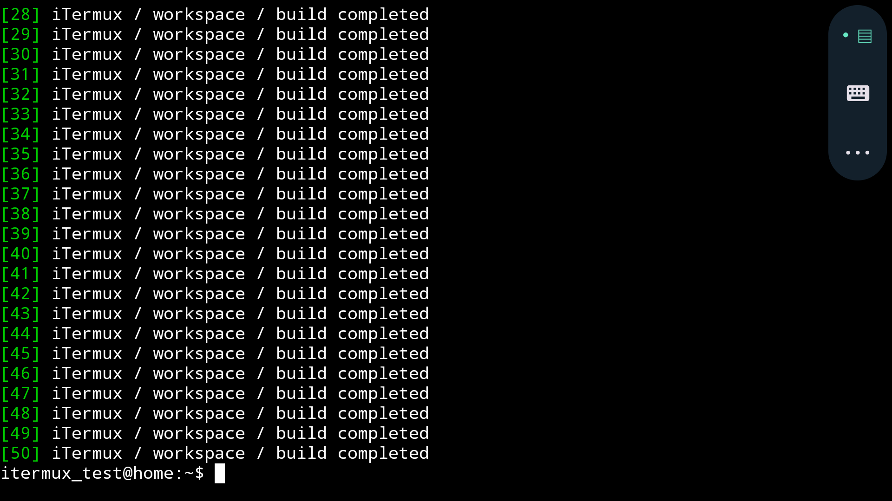
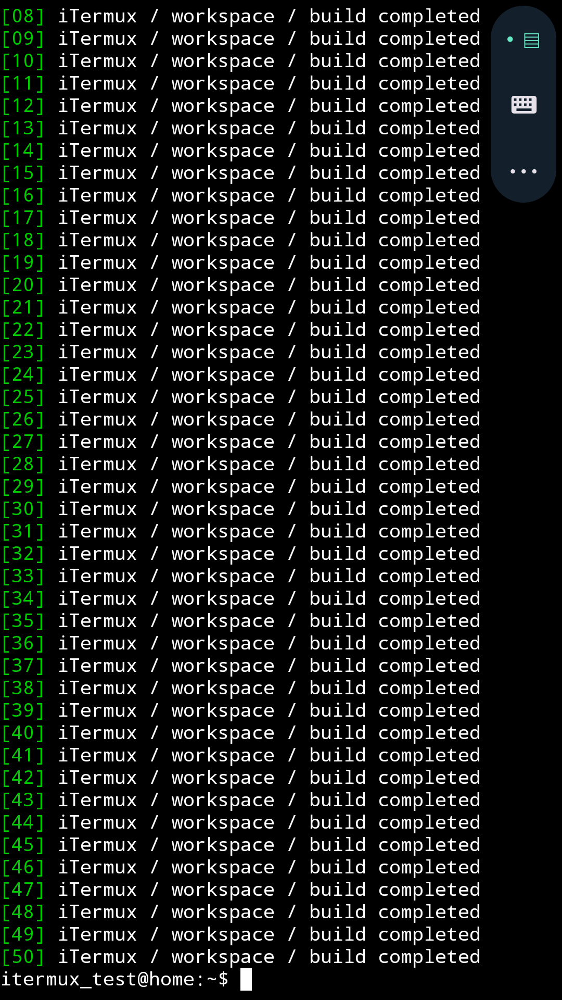

# iTermux 0.1.0 测试与交付记录

## 2026-09-25 传输进度、目录与双语界面

- 本机隔离 SFTP 夹具验证同名文件上传到两个不同目录、同一目标拒绝覆盖、下载大小与字节数匹配；上传目录菜单在进入另一目录时立即更新目标路径。
- 模拟器通过语言切换与 Activity 重建、传输进度弹窗、远端目录菜单和 Android 文档流往返 4 项专项测试；原有导航、会话标题、终端快捷键 3 项回归也通过。已目视检查[英文设置](screenshots/language-settings-en-emulator.png)及[上传进度](screenshots/transfer-progress-en-emulator.png)截图。
- App、SSH、终端模块共 180 项单测通过，11 项外部环境相关测试跳过，0 失败；Debug、AndroidTest 构建通过；lint 0 错误、10 条版本及既有界面建议警告。
- PLU110 的现装包与本轮 Debug 包证书一致；已保留数据覆盖安装最新 `io.itermux.app`。真机测试包安装仍需设备解锁并完成系统安装确认，因此上述 4 项专项结果目前来自模拟器与本机夹具。


首次验收：2026-09-14；界面优化复验：2026-09-15。应用 ID `io.itermux.app`，最低 Android 8 / API 26，compile/target SDK 36。此记录区分实际通过的检查、测试替身和需用户补验的项目。

## 2026-09-25 重构与最新验证

以下为当前工作树的最新结果；后续章节保留此前各轮验收时的状态。

- 将主屏卡片/对话框、终端操作栏/原生回调、主机编辑草稿分别收拢；SSH 命令、连接层轮询和终端视图的远程历史状态各有独立职责。导航标签去重，保留原有页面入口与测试标签。
- 最新 Debug、AndroidTest 构建和 lint 通过；本地 JVM 测试 **179 项通过、0 失败**，另有 **11 项**因可选外部 OpenSSH 夹具缺席而跳过。lint 为 **0 错误、11 警告**。[Gradle 输出](test-results/refactor-gradle.txt)。
- 专用回环 sshd、独立 tmux socket 和测试密钥下，真实 `TmuxHistoryIntegrationTest` **1 项通过、0 跳过**；模拟器 `TmuxHistoryUiTest` 从进入历史、滑块拖动到返回实时画面 **1 项通过**。[集成测试输出](test-results/refactor-tmux-integration.txt)与 [JUnit XML](test-results/refactor-tmux-integration.xml)。测试夹具及端口映射已清理，未连接用户保存的主机。
- Android 16 模拟器的 `NavigationThemeTest`、`TerminalLayoutTest`、`TerminalExtraKeysTest`、`TerminalDraftTest`、`TmuxHistoryUiTest` 各通过 1 项。横屏布局用例已按现行 96 dp 双列侧栏更新断言；键盘展开时单列侧栏可滚动。
- PLU110 真机使用默认包名 `io.itermux.app` 同签名覆盖更新。`NavigationThemeTest`、`TerminalExtraKeysTest`、`TerminalDraftTest` 各通过 1 项：[导航](test-results/refactor-navigation-phone.txt)、[快捷键](test-results/refactor-extra-keys-phone.txt)、[草稿粘贴](test-results/refactor-draft-phone.txt)。测试组件已卸载，手机上仅保留 `io.itermux.app`；未清除已有应用数据。

## 2026-09-25 界面与终端视觉复验

- 主机搜索改为标题栏入口，默认不占列表高度；展开后按名称、地址和用户名筛选，关闭时清除筛选并收起输入法。深石墨色界面与终端背景一致，薄荷绿用于连接状态、光标和重点操作。终端默认字号由 14 sp 调为 13 sp，已有用户字号偏好保留；字号未变化时不再重复触发终端/PTY 尺寸更新。
- 操作栏展开后有栏顶“×”可直接收起，收起后右上角“⋯”可重新展开。保留显式固定、键盘切换、额外按键与横屏滚动。历史滚动条在阅读旧内容时留下低对比度滑块；轨道淡出后，仅滑块附近可抓取，避免右边缘大范围透明区域误抢手势。
- 根据真机反馈，tmux 模式新增“历史 / 实时”入口。进入后可下滑浏览远端旧记录、拖动右侧滑块定位，并返回最新画面；远端历史位置来自 tmux 当前窗格，长距离拖动使用顶部/底部跳转或翻页，避免逐行重绘。普通 SSH 的本地历史行为保留。
- Android 16 模拟器的隔离包名 `io.itermux.devicecheck` 连接本机回环 SSH 字节夹具，已验证中英文终端输出、拖动滑块到旧内容、追加新输出保持阅读位置、拖回实时输出、操作栏收起/重开与额外按键发送。主机页搜索从默认收起到筛选再收起也通过。结果见[最终模拟器输出](test-results/apple-redesign-final-emulator.txt)；视觉证据：[紧凑主机页](screenshots/apple-redesign-hosts-compact.png)、[搜索展开](screenshots/apple-redesign-hosts-search.png)、[连接终端](screenshots/apple-redesign-terminal.png)、[中英文历史与滑块](screenshots/apple-redesign-scrollbar.png)。
- 一加 PLU110 真机的隔离包连接本机独立 OpenSSH + tmux 3.5a 测试会话，进入历史、下滑、拖动到最早行、拖回底部、退出复制模式均通过；[真机测试输出](test-results/apple-redesign-tmux-phone.txt)、[远端协议测试](test-results/apple-redesign-tmux-core.xml)、[真机界面](screenshots/apple-redesign-tmux-ui-phone.png)、[终端旧内容](screenshots/apple-redesign-tmux-history-phone.png)。独立回环 SSH 字节夹具上的本地历史、额外按键、操作栏测试也[通过](test-results/apple-redesign-local-scroll-phone.txt)。搜索框移除裁切高度后，真机[筛选测试](test-results/apple-redesign-search-phone.txt)与[画面](screenshots/apple-redesign-search-phone.png)通过。
- App、终端解析器、终端视图和 SSH 核心的 JVM 测试共 175 项通过、10 项可选外部 OpenSSH 测试跳过；隔离 Debug 与 AndroidTest 构建通过，lint 0 错误、9 条依赖/构建工具提示。[Gradle 输出](test-results/apple-redesign-gradle.txt)。新设计尚未写入 `dist/` 交付 APK，原包名 `io.itermux.app` 未在真机上覆盖安装；tmux 真机验证针对隔离的 macOS OpenSSH/tmux 会话，未连接用户保存的服务器。

## 2026-09-25 终端额外按键

- 参考 Termux 官方默认额外键布局，为现有侧边操作栏增加 `Esc`、`Tab` 和一次性 `Ctrl`，保留原有会话、键盘、方向与退格操作。`Ctrl` 有选中反馈，在下一个键盘字符后复位。
- 使用只监听本机 `127.0.0.1:22228` 的 SSH 字节回显夹具与 USB/模拟器端口反向映射，不使用手机已有的真实主机。Android 16 模拟器端到端测试 **1 项通过**：`Esc → 1B`、`Tab → 09`、`Ctrl` 加 `c → 03`、随后 `d → 64`；Compose 截图见 [按键布局](screenshots/extra-keys-emulator.png) 和 [Ctrl 选中状态](screenshots/extra-keys-ctrl-armed-emulator.png)。
- 补充模拟器 IME `commitText` 路径：`Ctrl` 加 `e → 05`，下一个 `f → 66`；横屏逐一滚动到六个额外按键并确认可见。截图发现整栏滚动会藏起会话入口，因此改为顶部固定会话、键盘和菜单，仅额外按键滚动；复验 **1 项通过**，见[横屏滚动到底部截图](screenshots/extra-keys-landscape-emulator.png)。
- 在模拟器启用软键盘后复验：横屏键盘收起时固定顶部入口；键盘弹出、工作区高度缩小时自动允许整栏滚动，以维持额外按键完整触摸区域。`TerminalExtraKeysTest` 同时检查这两种状态，**1 项通过**，见[仪器测试输出](test-results/extra-keys-emulator.txt)；模拟器原有软键盘设置在测试后恢复。
- 修复菜单“粘贴”覆盖未发送草稿的问题：文字插入光标处或替换选区，超长剪贴板截断时不拆开 UTF-16 代理对。`DraftPasteTest` 的 3 个单元测试，以及真实界面中输入中文草稿、左移光标、收起编辑器、再粘贴到中间的 `TerminalDraftTest` 均通过。额外按键与草稿两项仪器测试在最终隔离构建上共同通过，见[合并测试输出](test-results/terminal-input-emulator.txt)。测试恢复了原剪贴板。
- App 与终端解析器单元测试共 **160 项通过、0 失败**；Debug、AndroidTest APK 编译通过；lint **0 错误、12 条既有警告**。
- 最终复验还运行了 `ssh-core` 的 17 项测试：7 项通过、10 项因缺少可选的外部 OpenSSH 凭据而跳过；本轮真机的本机回环 SSH 测试另行覆盖了实际网络会话。默认 Debug APK 清单仍为 `io.itermux.app`；`git diff --check` 通过。
- 一加 PLU110 真机安装独立包名 `io.itermux.devicecheck` 和测试包，原 `io.itermux.app` 及主机数据未被覆盖。最终两项仪器测试在真机 **2 项通过、0 失败**，见[测试输出](test-results/terminal-input-phone.txt)：触摸点击 `Esc → 1B`、`Tab → 09`；触摸点击一次性 `Ctrl` 后通过终端输入法接口提交 `c → 03`，接着 `d → 64`；再验证 `Ctrl+e → 05`、普通 `f → 66`。竖屏[按键实图](screenshots/extra-keys-phone.png)与[Ctrl 选中状态](screenshots/extra-keys-ctrl-armed-phone.png)均来自隔离测试 App；横屏[实际 View 截图](screenshots/extra-keys-landscape-phone.png)显示顶部会话、键盘、菜单入口保留，额外按键可滚动触达。用例还验证横屏弹出输入法后各键可触达，原草稿在中间粘贴后的文字保留。终端只连接本机回环 SSH 测试夹具。
- 真机厂商启动确认弹窗一度抢走 ADB 字符注入焦点，随后手机自动锁屏；排除这两项环境干扰后，上述最终用例通过。测试时临时设置 USB 供电保持亮屏，结束已恢复原值 0，并移除端口映射。原 App 的签名证书 SHA-256 为 `8603c441676382c21e54f994595b3cf5d4f9c5210cff6d11b2e39822bde60881`，与仓库旧手机测试包及当前本机调试签名均不同；本轮只验证独立包名，**未覆盖升级原 App**。

## 2026-09-16 输入法连续退格与默认交互

已保留数据覆盖安装到连接的一加 Turbo 6 / PLU110，安装包 SHA-256 与本次 `dist/iTermux-0.1.0-phone-test.apk` 一致：`c8a5e8dbb3af6b94b33a61c04078c79a02951d3082aec85457b253488613bae3`。Debug 与 Release 均沿用原证书。

- 操作栏默认隐藏，右上角 ⋯ 展开；显式固定偏好仍保留。点击终端输入区自动弹出输入法，返回键或键盘按钮可收起。
- 终端收到间隔不超过 250 ms、持续 1000 ms 的输入法退格后，用 Ctrl+U、Ctrl+K 清空当前输入；同次长按只清空一次。支持普通 DEL 事件、`deleteSurroundingText` 和码点版本。点按正常删字符，操作栏删除按钮不参与持续退格推断。
- 向输入法提供实际光标所在逻辑行的有限文字上下文，支持自动折行和 UTF-16 选区；未提交中文与远端文字分开处理。微信输入法的兼容依据来自此前在此手机对 3.5.3 的协议实测：长按产生约 100 ms 间隔的普通 DEL，没有有效长按标志，且需要 extracted text 响应。
- 新增长按识别单元测试 **4 项通过**，覆盖初始长按延迟、一次清空、持续抑制、松开间隔及新输入重置。[记录](test-results/ime-backspace-unit.xml)。
- Android 8：默认隐藏、点击弹键盘及完整横竖屏布局 **3 项通过**，[记录](test-results/ime-layout-android8.txt)。补充折行上下文后最终版本的三种退格协议、行中间清空、后续输入、中文组合、Activity 重建、草稿按钮和滚动条 **3 项通过**，[记录](test-results/ime-input-android8.txt)。
- Debug、Release、仪器测试 APK 构建通过；lint 0 错误、12 条既有警告。
- 手机解锁后，微信输入法 3.5.3 **真实触摸长按测试通过**：光标左侧 60 个字符、右侧 `RIGHT`，按住输入法删除键 2.4 秒，两侧均被清空；随后输入 `KEPT`，远端仅收到 `KEPT`，先前 `HISTORY_KEPT` 历史仍存在。测试还确认点击终端自动弹出输入法、操作栏保持隐藏。[测试记录](test-results/ime-hold-phone-physical.txt)、[结果截图](screenshots/ime-hold-phone-passed.png)。所有交互均在专用回环 SSH 账号执行，未向用户服务器发送测试命令。此前锁屏导致的未验项已完成补验。
- 同一手机补充交互回归 **3 项通过**：三种退格协议、单次删除及清空后的输入、默认隐藏与反复打开/关闭键盘、左右光标和长按删除按钮、草稿中文与表情编辑、横竖屏切换、滚动条拖动和自动隐藏。[记录](test-results/ime-input-phone.txt)。手机实测与交互回归合计 **4 项通过**，APK 与交付文件的 SHA-256 再次核对一致。

使用边界：连续退格是兼容推断，快速连续点按也可能触发。清空当前输入仍要求远端支持 Ctrl+U/Ctrl+K；未改写第三方输入法自身行为。下方保留此前版本记录，默认显示及键盘行为以本节为准。

## 2026-09-15 输入控制与自动隐藏滚动条

新版已保留数据覆盖安装到连接的一加 Turbo 6 / PLU110（Android 16），手机安装包与 `dist/iTermux-0.1.0-phone-test.apk` 的 SHA-256 一致。Debug、Release 沿用各自原签名证书。

- 操作栏与草稿框新增左右光标和删除按钮；删除点按删字符、长按清空当前输入，不清除终端历史。终端移动/删除前处理 IME 组合文字，清空时丢弃未提交文字，避免之后再次上屏。
- 草稿按完整字符边界移动和删除，验证中文、表情、组合重音和家庭表情；旋转后保留草稿，编辑不自动写入 SSH。
- 右侧本地历史滚动条可拖动；闲置 1.2 秒后淡出，隐藏后仍能拖动。验证上下边界、拖到底部恢复输出、查看旧内容时新输出保持阅读位置，以及自动隐藏后的像素恢复。
- Android 8 模拟器：新增功能及键盘开关复验 **2 项通过**，[记录](test-results/input-controls-android8.txt)。完整横竖屏布局回归与初次新增功能测试 **2 项通过**，[记录](test-results/input-layout-android8.txt)。
- 一加手机：新增功能和连续三次键盘开关复验 **2 项通过**，[记录](test-results/input-controls-phone.txt)。所有输入和输出来自隔离回环 SSH 测试账号，未向用户真实服务器发送测试命令。
- Debug / Release / 仪器测试 APK 构建通过；lint 0 错误、12 条既有警告；149 项终端解析器单元测试通过。

使用边界：终端清空采用 Ctrl+U、Ctrl+K，远端程序需支持相应快捷键。滚动条反映本地历史，tmux/vim 等全屏程序的历史仍由远端滚动或复制模式处理。

截图：[手机竖屏编辑](screenshots/input-controls-phone-portrait-editor.png)、[手机横屏编辑](screenshots/input-controls-phone-landscape-editor.png)、[手机历史滚动条](screenshots/input-controls-phone-scrollbar.png)。下方保留此前界面的验收记录，新增输入与滚动行为以本节为准。

## 此前界面

连接页横竖屏默认用满可用区域，隐藏状态栏和系统导航栏；边缘滑动可临时呼出。右侧悬浮操作栏默认展开，按钮沿终端滚动条方向竖排，轻触终端保持展开。菜单中的“固定操作栏”可固定为右侧 48 dp 栏，偏好持久保存；“隐藏操作栏”取消固定并隐藏按钮，右上角“⋯”用于恢复。终端内容延伸到摄像头开孔周围，仅操作按钮单独避让开孔；自由窗口的系统标题栏仍会避让。回到主机页恢复系统栏。

默认隐藏键盘，轻触终端不弹键盘。键盘按钮第一次点击打开输入法，再次点击收起，输入法开关不移动按钮。快捷键入口、面板和 Ctrl 锁定状态已删除。横屏编辑框与发送、回车等动作排列在同一行；编辑时暂时收起操作栏，关闭编辑框后恢复。键盘打开时限制编辑框高度，关闭后重新应用沉浸显示。主机页横竖屏均合并搜索与添加按钮，竖屏移除重复的大标题，横屏合并标题和导航，列表按可用宽度自动分栏。

2026-09-15 按用户要求移除语音按钮，改从更多菜单打开“编辑文本”，点击编辑框输入。文字先进入草稿；发送文本和回车独立操作。

操作栏调整时的验证：Debug / Release APK 构建、Android 仪器测试 APK 编译、`lintDebug` 均通过。Android 8 和 Android 17 的布局回归均通过，覆盖默认展开、竖排、轻触保持展开、固定与重建、手动隐藏和恢复、编辑框开关，以及横竖屏浮动和固定状态各三次键盘开关（包含系统返回键）。触摸测试同时检查按钮位置稳定、键盘关闭后不反弹，以及没有快捷键面板和菜单项。记录：[Android 8](test-results/controls-android8.txt)、[Android 17](test-results/controls-android17.txt)。

连接的 PLU110 手机使用微信输入法（`com.tencent.wetype`），键盘专项触摸测试通过：连续三次打开/收起（包含系统返回键），收起后轻触终端不重新弹出键盘，操作栏保持展开。记录：[手机键盘复验](test-results/controls-phone.txt)。新版已保留数据覆盖安装到手机；Debug / Release 交付 APK 均通过签名校验，证书与各自旧包一致，SHA-256 已更新。





尺寸记录：[Android 8](test-results/controls-measurements-android8.txt)、[Android 17](test-results/controls-measurements-android17.txt)。截图中的主机及终端输出来自隔离测试环境；只在测试中临时取消安全截图标记。以下章节保留较早版本的验收记录，相关操作栏、快捷键和语音行为以本节为准。

## 2026-09-15 终端顶部留白修正

PLU110 的窗口报告摄像头安全区域为顶部 141 px。此前终端根布局对整个页面应用 `displayCutout`，即使隐藏系统栏也会留下整条空白；现改为终端内容延伸到屏幕边缘，仅操作按钮避让开孔。布局断言改为检查终端顶部和左侧没有开孔边距。

Debug / Release 构建、仪器测试编译及 `lintDebug` 通过。Android 17 启用模拟摄像头开孔后，完整布局和键盘回归通过：默认竖屏终端为 1080 × 1920，横屏为 1920 × 1080，与整个窗口尺寸一致；固定栏仅占右侧宽度。记录：[测试输出](test-results/fullscreen-cutout-android17.txt)、[尺寸记录](test-results/fullscreen-cutout-measurements.txt)、[竖屏截图](screenshots/fullscreen-cutout-layout-portrait-floating.png)、[横屏截图](screenshots/fullscreen-cutout-layout-landscape-floating.png)。

交付 APK 已更新并通过原证书签名校验，新版已保留数据覆盖安装到手机。此次手机处于锁屏状态，未完成新版的真机界面复验；上方手机键盘结果属于此前操作栏修改版本。

## 2026-09-15 悬浮操作栏与空间利用优化

在 1080 × 1920、无开孔模拟器上，默认竖屏终端由 1080 × 1794 扩展为 1080 × 1920，横屏由 1794 × 1080 扩展为 1920 × 1080；相较原来的默认固定栏，终端面积增加约 7%。展开悬浮操作栏后终端尺寸保持不变，只有浮层所在的小块区域被遮挡。编辑时不再叠加操作栏，竖屏省下 48 dp 高度，横屏省下 48 dp 宽度。

本次布局回归覆盖默认全屏、展开及轻触收起悬浮栏、固定及 Activity 重建、横竖屏切换、键盘缩放终端、中文多行草稿、收起编辑后恢复全屏、返回主机页恢复系统栏。既有回归继续覆盖真实 SSH、中文组合输入、远端 Codex 菜单及主机保存与搜索。测试为模拟器临时开启软键盘并关闭首次全屏教学浮层，结束后恢复原设置。

- Debug、Release APK 构建通过；lint 0 错误，12 条警告（依赖版本提示及 SharedPreferences 的 KTX 风格建议）。
- Android 8 与 Android 17 各通过 3 项界面回归：[Android 8 输出](test-results/floating-android8.txt)、[Android 17 输出](test-results/floating-android17.txt)。
- Android 17 额外启用模拟打孔屏后，全套布局测试通过，确认只避让开孔所需边距：[打孔屏输出](test-results/floating-cutout-android17.txt)。
- 完整尺寸记录：[Android 8](test-results/floating-measurements-android8.txt)、[Android 17](test-results/floating-measurements-android17.txt)、[模拟打孔屏](test-results/floating-measurements-cutout-android17.txt)。

尺寸与窗口边距仍按 [Android 窗口边距说明](https://developer.android.com/develop/ui/compose/system/insets)避让开孔、窗口标题栏与输入法；第三方输入法和设备开孔会影响实际可用区域。本次未在已锁屏的 PLU110 上运行界面测试。

## 2026-09-15 前一版固定操作栏复验

- Debug、Release APK 构建通过；lint 0 错误、10 条既有警告。
- Android 8 / API 26 和 Android 17 / API 37.1 均通过新增的全屏布局测试，覆盖横竖屏、终端尺寸与远端 PTY 更新、横屏键盘、中文多行草稿不自动发送、隐藏/恢复操作栏、旋转后保持隐藏状态、返回主机页恢复系统栏。
- 两版系统的既有界面回归测试通过，包括中文组合输入、Activity 重建、语音草稿、真实远端 Codex 菜单、主机添加与搜索。Android 8 的旧系统栏可见性由兼容 API 估算，测试结合原生隐藏标志、实际窗口尺寸与截图验证。
- 自动化测试仅在模拟器启用软键盘并抑制首次全屏教学提示，测试结束恢复原设置。生产应用保留 Android 正常教学提示，不修改系统设置。

两个 1080 × 1920、无开孔模拟器的实测结果一致：

| 模式 | 终端像素尺寸 | 屏幕利用率 |
| --- | --- | --- |
| 竖屏，操作栏可见 | 1080 × 1794 | 宽度 100%，高度 93.4% |
| 横屏，操作栏可见 | 1794 × 1080 | 宽度 93.4%，高度 100% |
| 隐藏操作栏 | 与屏幕相同 | 终端区域 100%；右上角保留一个小型恢复按钮 |

原始布局数据：[Android 8](test-results/layout-measurements-android8.txt)、[Android 17](test-results/layout-measurements-android17.txt)。测试输出：[Android 8 布局复验](test-results/layout-android8.txt)、[Android 17 布局与界面回归](test-results/layout-android17.txt)。设备开孔和第三方输入法高度会影响实际可用空间；本次没有执行微信输入法的真实语音识别。

## 首版自动化结果（2026-09-14）

| 范围 | 结果 | 验证内容 |
| --- | --- | --- |
| terminal-emulator JVM | 149 通过，0 失败，0 跳过 | UTF-8 分片、中文与 emoji 宽度、颜色、控制序列、键码、滚动、尺寸变化、历史上限、bracketed paste、OSC 52 禁写剪贴板 |
| ssh-core JVM + OpenSSH | 17 通过，0 失败，0 跳过 | 信任策略 6 项、真实连接及异常分支 11 项 |
| Android 8 / API 26 模拟器 | 8 通过 | Keystore、Room、四种认证、终端/输入/页面/生命周期组合测试 |
| Android 17 / API 37.1 模拟器 | 8 通过 | 同上，使用 16 KiB 页面系统镜像 |
| 两个模拟器的进程死亡测试 | 各 1 项恢复断言通过 | 先连接普通 SSH 和 tmux，外部终止整个应用进程，再检查持久化和显式恢复 |
| lint | 0 错误，10 警告 | 保留固定依赖版本更新提示和非阻断风格建议 |
| 正式签名 APK 安装 | 两个模拟器通过 | 全新安装 code 1 → 同证书覆盖升级 code 2 → 强制停止再启动；最后恢复交付的 code 1 |

原始记录见 [Android 8](test-results/android8.txt)、[Android 17](test-results/android17.txt)、[单元与 SSH 逐项结果](test-results/unit-and-ssh.json)、[Android 8 进程重建](test-results/process-death-android8.txt)、[Android 17 进程重建](test-results/process-death-android17.txt)、[安装升级](test-results/install-upgrade.txt)。

真实连接覆盖：密码、keyboard-interactive、加密 Ed25519、加密 RSA、错误密码分类、取消首次信任且不存指纹、主机公钥变化阻断、静默连接超时、已连接网络断开后拒绝输入、PTY 101×37、tmux 重附着、Ctrl+C 中断任务、vim 启动和退出。缺失 tmux 分支使用第二个隔离 OpenSSH 端点强制让探测命令返回失败；没有卸载服务器原有 tmux。

设备测试通过实际 InputConnection 验证中文组合输入未提交前不向远端发送拼音、提交后可显示中文；通过编辑框提交模拟语音识别完成后的文字，确认它仅进入草稿、不自动发送。没有用合成测试替代真实语音识别质量的声明。默认键盘隐藏、编辑框收起后隐藏键盘、轻触终端不弹键盘以及终端高度超过根视图 80% 均有断言。

旋转检查确认终端列数随横竖屏增减且连接保持。后台检查解除测试和 Activity 绑定，确认服务仍处于前台状态且 SSH 已连接。锁屏检查为约 1.2 秒的模拟器熄屏/唤醒，不能代表长时间 Doze。进程重建检查确认新服务会话列表为空，普通 SSH 不显示为恢复；Room 中主机和 Keystore 密文仍可读取，手动重连 tmux 后保留的 shell 变量仍在。

## 真机

设备报告型号 PLU110，Android 16 / API 36，通过已授权 USB 调试安装。界面调整前，6 项存储/认证测试及 2 项终端/主机界面测试均通过。新版覆盖安装成功，保留原开发签名及 2 个主机，没有卸载或清除用户数据。

新版的 6 项存储/认证检查通过；最新界面复验在启动阶段受手机锁屏阻挡，尚待用户解锁后完成。当前输入法为微信输入法。实际麦克风录音、识别准确率及该手机长时间后台行为尚未完成验收；用户选择继续使用微信输入法语音，默认收起键盘。

## 远端环境与 AI 工具

使用隔离的 WSL Ubuntu 22.04 测试账号 `itermux_test`，OpenSSH 8.9p1 Ubuntu-3ubuntu0.16、tmux 3.2a、Vim 8.2。测试端口仅监听 Linux 回环地址，经 adb reverse 连接手机/模拟器。测试使用独立随机密码及公开测试私钥，没有使用用户真实主机凭据，也没有更改系统 sshd 配置。

实际运行官方 Codex CLI **0.154.0** Linux musl 版本，下载 URL 与 SHA-256 在 `test-tool.lock.json`。终端执行 `codex --version`，启动交互登录菜单，发送方向键并退出。未登录 AI 账号、未调用模型、未验证模型生成代码；这部分需用户已有远端账号补验。Codex 二进制不包含在 APK 或源码包中。

## 签名与文件

`dist/iTermux-0.1.0.apk` 是独立发布签名版本，RSA 3072 位，APK v2 签名校验通过。发布证书 SHA-256：

```text
ed63b0c6b646f8bfb5446ad89e51e5a558fcd6ac9cd8bc28d788431803117a71
```

`dist/iTermux-0.1.0-phone-test.apk` 与手机现有开发签名相同，用于保留数据覆盖更新。开发签名的私钥原件与单独备份位置在 README 中；独立发布密钥和 `signing.properties` 均排除在源码包外。

APK 的 SHA-256 见 `dist/SHA256SUMS.txt`，签名验证输出见 `dist/signature.txt` 和 `dist/phone-test-signature.txt`。源码归档包含构建脚本、固定版本、终端库、许可和本测试记录，排除 SDK、缓存、签名密钥、随机测试密码、Codex 二进制及 APK。

## 后续补验

- 解锁 PLU110 后复验新版界面和微信输入法麦克风的真实听写；外接实体键盘及选择复制手势仍需真机操作覆盖。
- 使用自己的远端 AI 账号完成一次真实模型请求。
- 在实际 VPN、移动网络/Wi-Fi 切换、长时间锁屏和厂商省电策略下补验；本次网络中断使用可控 TCP 断流测试。
- 当前同签名升级只提高版本号，未涉及未来数据库 schema 变更；后续 Room 迁移需随变更单独验收。
