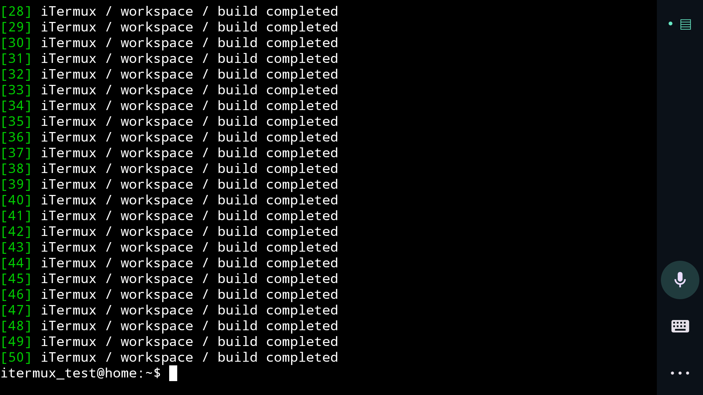
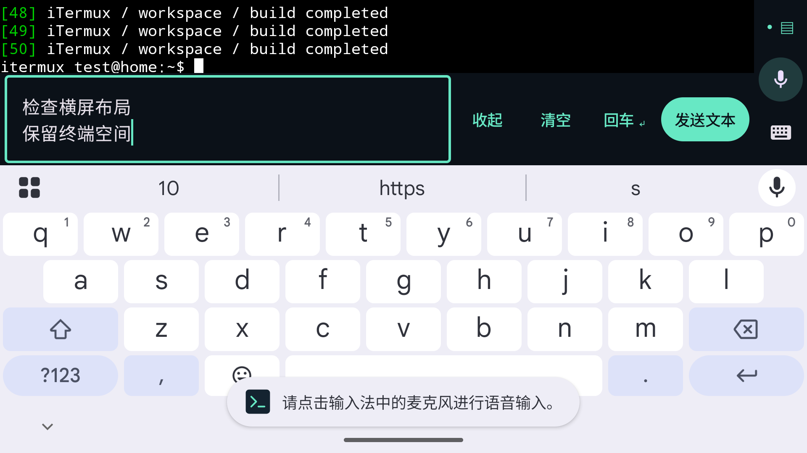

# iTermux 0.1.0 测试与交付记录

首次验收：2026-09-14；界面优化复验：2026-09-15。应用 ID `io.itermux.app`，最低 Android 8 / API 26，compile/target SDK 36。此记录区分实际通过的检查、测试替身和需用户补验的项目。

## 最终界面

连接页默认沉浸显示，隐藏状态栏和系统导航栏；边缘滑动可临时呼出。竖屏保留 48 dp 底栏，横屏改为 48 dp 右侧栏。菜单中的“隐藏操作栏”将终端扩展至整个可用区域；右上角悬浮按钮或返回键恢复操作栏。摄像头开孔和自由窗口标题栏仍会避让。回到主机页恢复系统栏。

默认隐藏键盘，轻触终端不弹键盘。横屏编辑框与发送、回车等动作排列在同一行；编辑时收起快捷键，键盘打开时限制编辑框高度。主机页横屏合并标题和导航，搜索与添加按钮同排，列表按可用宽度自动分栏。

按用户选择，语音入口打开编辑框和当前输入法，需再点击微信输入法的麦克风。识别文字由输入法提交到草稿；发送文本和回车独立操作。应用未集成独立语音模型，也没有自动触发输入法内部麦克风。





竖屏完全展开见 [终端截图](screenshots/terminal-portrait-full.png)，横屏主机页见 [双栏列表](screenshots/hosts-landscape.png)。截图中的主机及终端输出来自隔离测试环境；只在测试中临时取消安全截图标记。

## 2026-09-15 界面优化复验

- Debug、Release APK 构建通过；lint 0 错误、10 条既有警告。
- Android 8 / API 26 和 Android 17 / API 37.1 均通过新增的全屏布局测试，覆盖横竖屏、终端尺寸与远端 PTY 更新、横屏键盘、中文多行草稿不自动发送、隐藏/恢复操作栏、旋转后保持隐藏状态、返回主机页恢复系统栏。
- 两版系统的既有界面回归测试通过，包括中文组合输入、Activity 重建、语音草稿、真实远端 Codex 菜单、主机添加与搜索。Android 8 的旧系统栏可见性由兼容 API 估算，测试结合原生隐藏标志、实际窗口尺寸与截图验证。
- 自动化测试仅在模拟器启用软键盘并抑制首次全屏教学提示，测试结束恢复原设置。生产应用保留 Android 正常教学提示，不修改系统设置。

两个 1080 × 1920、无开孔模拟器的实测结果一致：

| 模式 | 终端像素尺寸 | 屏幕利用率 |
| --- | --- | --- |
| 竖屏，操作栏可见 | 1080 × 1794 | 宽度 100%，高度 93.4% |
| 横屏，操作栏可见 | 1794 × 1080 | 宽度 93.4%，高度 100% |
| 隐藏操作栏 | 与屏幕相同 | 终端区域 100%；右上角保留一个小型恢复按钮 |

原始布局数据：[Android 8](test-results/layout-measurements-android8.txt)、[Android 17](test-results/layout-measurements-android17.txt)。测试输出：[Android 8 布局复验](test-results/layout-android8.txt)、[Android 17 布局与界面回归](test-results/layout-android17.txt)。设备开孔和第三方输入法高度会影响实际可用空间；本次没有执行微信输入法的真实语音识别。

## 首版自动化结果（2026-09-14）

| 范围 | 结果 | 验证内容 |
| --- | --- | --- |
| terminal-emulator JVM | 149 通过，0 失败，0 跳过 | UTF-8 分片、中文与 emoji 宽度、颜色、控制序列、键码、滚动、尺寸变化、历史上限、bracketed paste、OSC 52 禁写剪贴板 |
| ssh-core JVM + OpenSSH | 17 通过，0 失败，0 跳过 | 信任策略 6 项、真实连接及异常分支 11 项 |
| Android 8 / API 26 模拟器 | 8 通过 | Keystore、Room、四种认证、终端/输入/页面/生命周期组合测试 |
| Android 17 / API 37.1 模拟器 | 8 通过 | 同上，使用 16 KiB 页面系统镜像 |
| 两个模拟器的进程死亡测试 | 各 1 项恢复断言通过 | 先连接普通 SSH 和 tmux，外部终止整个应用进程，再检查持久化和显式恢复 |
| lint | 0 错误，10 警告 | 保留固定依赖版本更新提示和非阻断风格建议 |
| 正式签名 APK 安装 | 两个模拟器通过 | 全新安装 code 1 → 同证书覆盖升级 code 2 → 强制停止再启动；最后恢复交付的 code 1 |

原始记录见 [Android 8](test-results/android8.txt)、[Android 17](test-results/android17.txt)、[单元与 SSH 逐项结果](test-results/unit-and-ssh.json)、[Android 8 进程重建](test-results/process-death-android8.txt)、[Android 17 进程重建](test-results/process-death-android17.txt)、[安装升级](test-results/install-upgrade.txt)。

真实连接覆盖：密码、keyboard-interactive、加密 Ed25519、加密 RSA、错误密码分类、取消首次信任且不存指纹、主机公钥变化阻断、静默连接超时、已连接网络断开后拒绝输入、PTY 101×37、tmux 重附着、Ctrl+C 中断任务、vim 启动和退出。缺失 tmux 分支使用第二个隔离 OpenSSH 端点强制让探测命令返回失败；没有卸载服务器原有 tmux。

设备测试通过实际 InputConnection 验证中文组合输入未提交前不向远端发送拼音、提交后可显示中文；通过编辑框提交模拟语音识别完成后的文字，确认它仅进入草稿、不自动发送。没有用合成测试替代真实语音识别质量的声明。默认键盘隐藏、编辑框收起后隐藏键盘、轻触终端不弹键盘以及终端高度超过根视图 80% 均有断言。

旋转检查确认终端列数随横竖屏增减且连接保持。后台检查解除测试和 Activity 绑定，确认服务仍处于前台状态且 SSH 已连接。锁屏检查为约 1.2 秒的模拟器熄屏/唤醒，不能代表长时间 Doze。进程重建检查确认新服务会话列表为空，普通 SSH 不显示为恢复；Room 中主机和 Keystore 密文仍可读取，手动重连 tmux 后保留的 shell 变量仍在。

## 真机

设备报告型号 PLU110，Android 16 / API 36，通过已授权 USB 调试安装。界面调整前，6 项存储/认证测试及 2 项终端/主机界面测试均通过。新版覆盖安装成功，保留原开发签名及 2 个主机，没有卸载或清除用户数据。

新版的 6 项存储/认证检查通过；最新界面复验在启动阶段受手机锁屏阻挡，尚待用户解锁后完成。当前输入法为微信输入法。实际麦克风录音、识别准确率及该手机长时间后台行为尚未完成验收；用户选择继续使用微信输入法语音，默认收起键盘。

## 远端环境与 AI 工具

使用隔离的 WSL Ubuntu 22.04 测试账号 `itermux_test`，OpenSSH 8.9p1 Ubuntu-3ubuntu0.16、tmux 3.2a、Vim 8.2。测试端口仅监听 Linux 回环地址，经 adb reverse 连接手机/模拟器。测试使用独立随机密码及公开测试私钥，没有使用用户真实主机凭据，也没有更改系统 sshd 配置。

实际运行官方 Codex CLI **0.154.0** Linux musl 版本，下载 URL 与 SHA-256 在 `test-tool.lock.json`。终端执行 `codex --version`，启动交互登录菜单，发送方向键并退出。未登录 AI 账号、未调用模型、未验证模型生成代码；这部分需用户已有远端账号补验。Codex 二进制不包含在 APK 或源码包中。

## 签名与文件

`dist/iTermux-0.1.0.apk` 是独立发布签名版本，RSA 3072 位，APK v2 签名校验通过。发布证书 SHA-256：

```text
ed63b0c6b646f8bfb5446ad89e51e5a558fcd6ac9cd8bc28d788431803117a71
```

`dist/iTermux-0.1.0-phone-test.apk` 与手机现有开发签名相同，用于保留数据覆盖更新。开发签名的私钥原件与单独备份位置在 README 中；独立发布密钥和 `signing.properties` 均排除在源码包外。

APK 的 SHA-256 见 `dist/SHA256SUMS.txt`，签名验证输出见 `dist/signature.txt` 和 `dist/phone-test-signature.txt`。源码归档包含构建脚本、固定版本、终端库、许可和本测试记录，排除 SDK、缓存、签名密钥、随机测试密码、Codex 二进制及 APK。

## 后续补验

- 解锁 PLU110 后复验新版界面和微信输入法麦克风的真实听写；外接实体键盘及选择复制手势仍需真机操作覆盖。
- 使用自己的远端 AI 账号完成一次真实模型请求。
- 在实际 VPN、移动网络/Wi-Fi 切换、长时间锁屏和厂商省电策略下补验；本次网络中断使用可控 TCP 断流测试。
- 当前同签名升级只提高版本号，未涉及未来数据库 schema 变更；后续 Room 迁移需随变更单独验收。
