# Roamtty 使用指南

Roamtty 是一个 Android SSH 客户端，专为在手机上远程使用 Claude Code、Codex、Grok 等 AI 编程工具而设计。5 分钟上手：**添加主机 → 新建会话 → 在终端里干活**。

> 截图来自模拟器测试环境，主机名与地址为测试数据。应用内左上角菜单 →「帮助」也有一份速查。

## 1. 添加主机

首页切到「主机」，点右上角 **+**。

1. 填写名称、地址、端口和用户名。
2. 选认证方式：**密码**、**私钥**（Ed25519 / RSA，支持加密私钥）或**交互式认证**。
3. 勾选「在本机加密保存密码」可免去每次输入（用系统 Keystore 加密）；私钥口令永不保存。
4. 会话模式推荐 **tmux**：断网、锁屏或关掉 App 后，远端任务继续运行，重连即回到原处。
5. 点「保存」。首次连接会弹出服务器指纹，确认无误后点「信任并连接」。

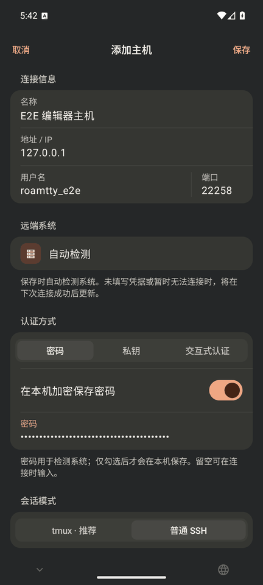
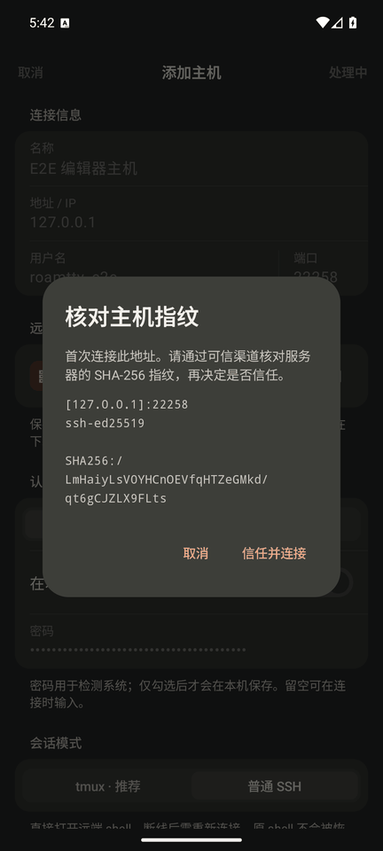
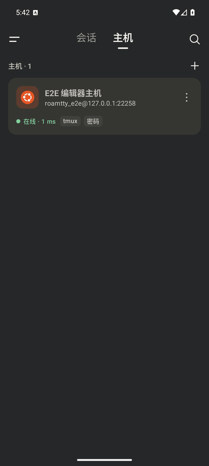

主机卡片显示系统图标、在线状态与建连延时。卡片右侧 **⋮** 可打开终端、查看文件、启动 AI Agent、安装插件、编辑或删除主机。

> 指纹之后如果变化，Roamtty 会直接阻止连接，防止中间人攻击。只有你确认服务器确实重装过，才在提示里「重新核验」。

## 2. 新建会话，启动 AI Agent

首页切到「会话」，点 **+**：

1. 选择要运行的 Agent（**Claude Code**、**Codex**、**Grok**），或选「终端」只开普通 shell。
2. 选主机，再选起始文件夹。
3. 选权限：**只读**（Claude Code 为计划模式）、**普通**（改文件或运行命令前先问你）或 **YOLO**（跳过确认）。App 会记住上次的选择。
4. 点「在 … 启动」。

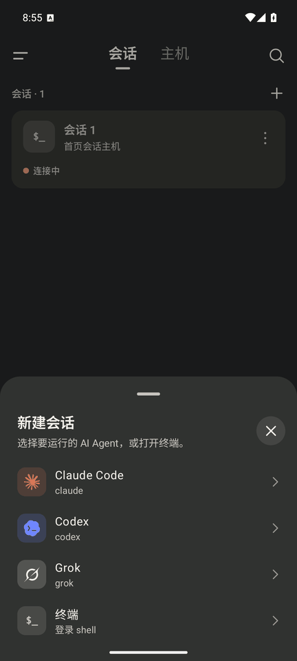
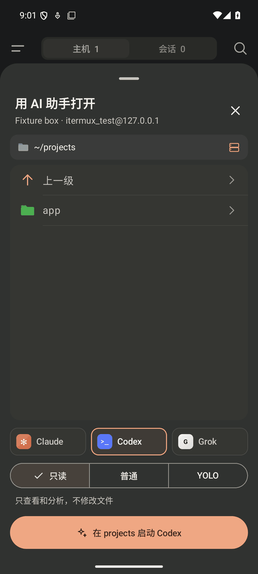
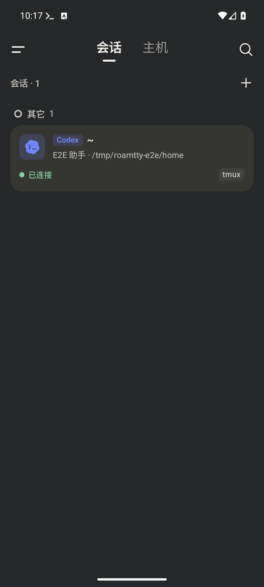

会话卡片以 Agent 当前的任务为标题，显示「运行中 / 等待确认 / 空闲」等状态，一眼就能看出哪个 Agent 在等你回复。每台主机最多 8 个会话。

> Roamtty 本身不带模型，AI 工具需要事先装在远端主机上。

## 3. 终端操作

终端全屏显示。所有操作都靠手势和右侧的小幽灵完成：

| 手势 | 作用 |
| --- | --- |
| 点击光标所在行 | 弹出键盘（点其他位置不弹出） |
| 双击 | 发送 Tab（补全），小幽灵旁出现 ↑ ↓ ← 键选择补全项 |
| 三击 | 粘贴剪贴板 |
| 左右滑动 | 发送 ← / →；滑动后按住不放跳到行首 / 行尾 |
| 上下滑动 | 回看历史输出（tmux 会话滚动 tmux 自身的历史） |
| 双指缩放 | 调整字号 |
| 长按命令行 | 放大镜拖动光标 |
| 长按其他输出 | 选择并复制 |
| 单击链接 | 用浏览器（GitHub 链接优先用 GitHub App）打开 |
| **长按小幽灵** | 弹出快捷键环（Esc、Ctrl、Shift、F1–F12 等，随前台程序变化），拖到某键上松手即发送 |

光标行末尾常驻一个 **Esc** 键；停止输入后它会变成**回车**键。

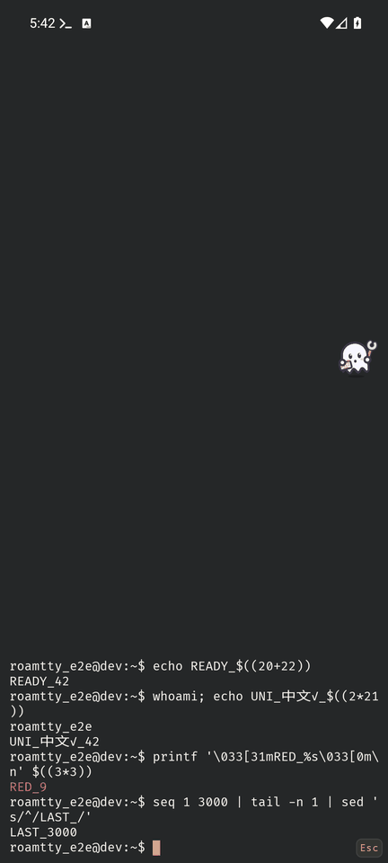
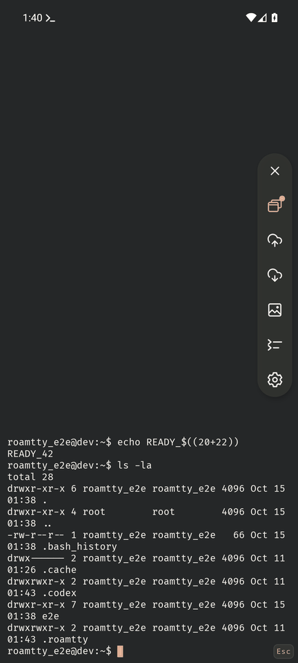
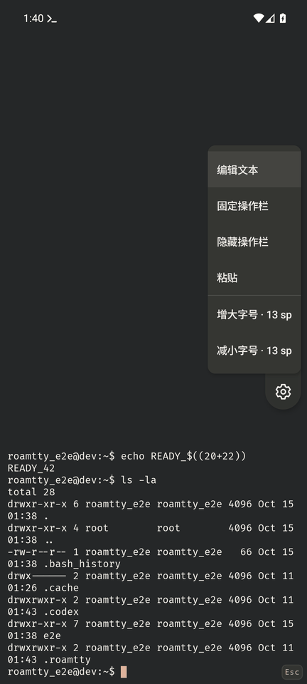

**点一下小幽灵**展开操作栏，从上到下依次是：

- **会话菜单**：返回主机详情、关闭或重启当前会话、切换到其他会话
- **上传文件** / **下载文件**
- **插入图片**：一次最多 9 张，上传后自动把远端路径填进命令行，方便发给 AI
- **常用命令**：读取远端 shell 历史，点一条就执行
- **设置**：编辑文本（在大输入框里写好再发送，适合长提示词）、固定 / 隐藏操作栏、粘贴、调整字号

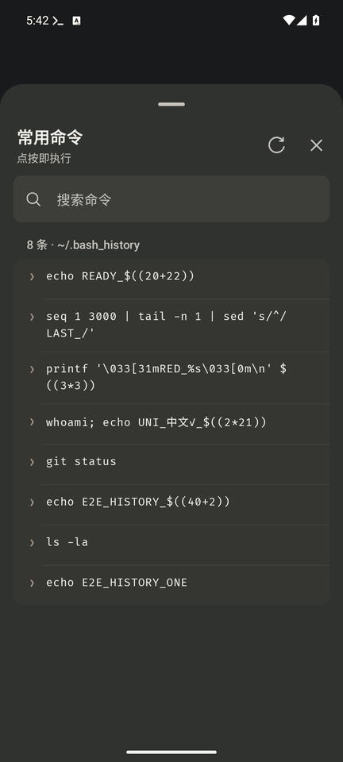

## 4. 文件

主机菜单 →「查看文件」通过 SFTP 浏览远端目录：

- 预览文本、代码（带高亮）、Markdown 和图片，支持在文件内搜索
- 重命名、删除、新建文件夹、复制路径、单个或批量下载
- 在当前文件夹直接打开终端或启动 AI Agent
- 在相册等其他 App 里把图片「分享」给 Roamtty，即可上传到某个会话

首次下载时需选择一个本机下载目录，之后自动保存到那里。

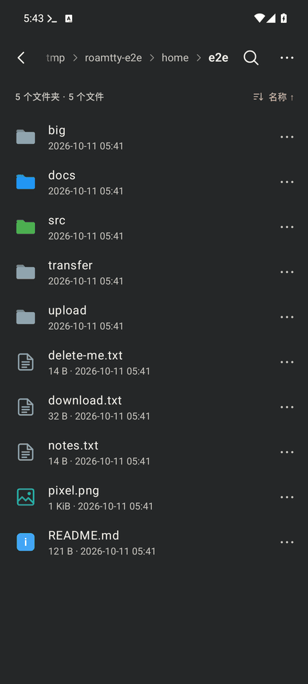
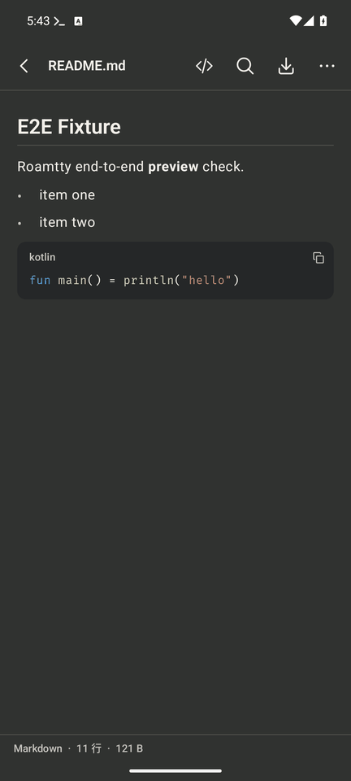
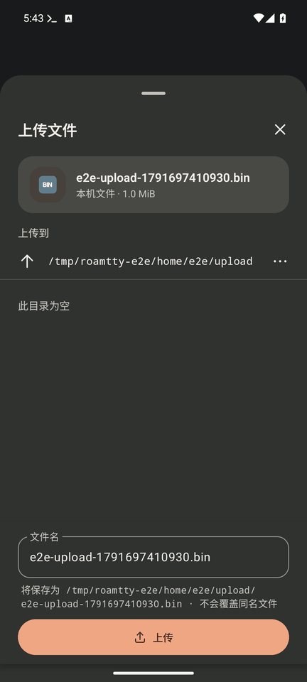

## 5. 主机详情与插件

点主机卡片进入详情页，实时查看 CPU、内存、磁盘、网络、GPU 和占用最高的进程，顶部按钮可直接启动 AI Agent、打开终端或查看文件。

右上角 **⋯** →「安装插件」可一键检测并安装：

- **tmux**：会话保持，强烈推荐
- **mosh**：基于 UDP，切换网络或锁屏后自动恢复，弱网更流畅（需放行 UDP 60000–61000，8 秒无回应自动回退 SSH）

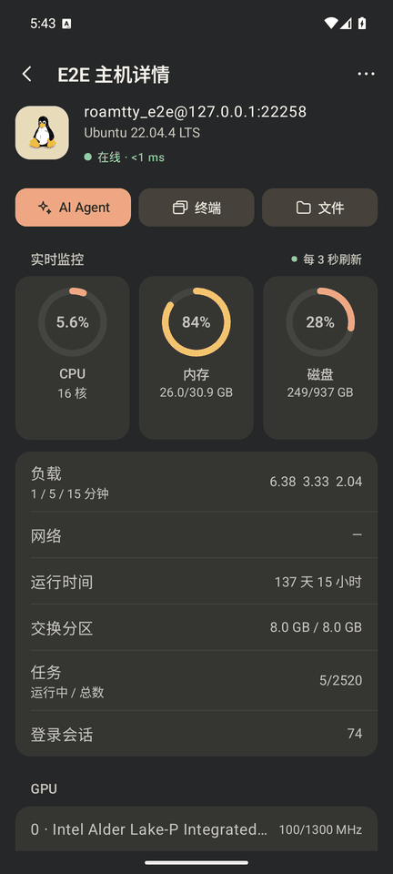
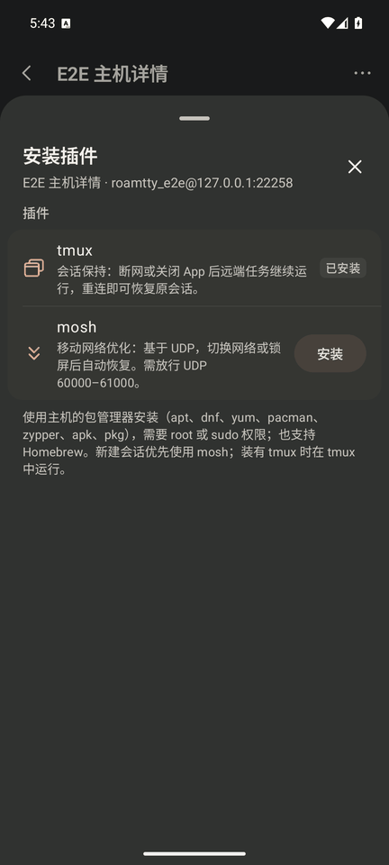
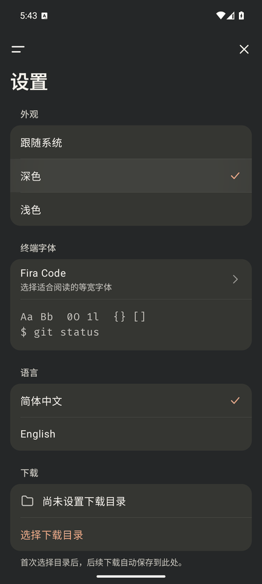

## 5.1 远程桌面（实验功能）

在「设置 › 实验功能」打开「远程桌面」后，能开桌面的主机会在会话卡片右下角（「追问」右边）显示桌面按钮；没有会话的主机，在主机详情页点「桌面」。

- **第一次点**：自动安装桌面插件（主机直接下载，下载不了就由手机下载后上传），装完直接进入画面，不需要填任何配置。
- **桌面页**：右侧竖栏（竖屏在底部）有「操作」「键盘」「显示桌面」「所有窗口」。
  - 屏幕触控（默认）：轻点 = 左键，长按 = 右键，轻点后立即按住拖动 = 拖拽，双指滑动 = 滚轮，双指捏合 = 缩放。
  - 鼠标指针：单指移动光标，轻点在光标处点击。
  - 键盘：「输入法」页把打好的字（含中文）直接发到电脑；「电脑键盘」页按物理位置发键，修饰键点一下锁一次、长按常驻，「组合键」可攒齐再发。
  - 「操作」里还有：退出、文件、断开、剪贴板、仅观看、虚拟鼠标、帧率、画质、显示器、断开后锁定电脑。
- **退出**桌面页后连接在后台保持（默认 10 分钟，可在设置里改为 5 / 30 分钟），卡片按钮显示绿色角标，再点约 1 秒回到画面。
- 画面在主机可达时自动走 UDP（端口 60000–61000，和 mosh 相同），丢包靠前向纠错恢复、弱网自动降档；UDP 被防火墙挡住时自动走 SSH，3 秒内切换，不用设置。网络状态角标里能看到当前链路、延迟、丢包和 FEC 恢复次数。
- 同一台电脑只允许一台手机控制：另一台设备打开后，这边会提示「已在另一台设备上打开」。
- 支持的主机：
  - **Linux**：X11 桌面；Wayland 支持 wlroots 系合成器（sway、Hyprland、labwc、river）。GNOME / KDE 的 Wayland 会话暂不支持，可在登录界面选 X11 会话。
  - **macOS 13+**：第一次打开时会在 Mac 上弹出两次授权，请在“系统设置 › 隐私与安全性”的“屏幕与系统音频录制”和“辅助功能”里打开 Roamtty Desktop，手机这边会自动连上。插件是经 Apple 公证的 Developer ID 应用，升级后授权仍然有效。
  - **Windows 10 1903+ / 11**：需要已在电脑上登录桌面（插件以登录任务运行在你的桌面会话里），无需其它操作。
- 没有图形桌面的服务器不显示按钮。

## 6. 设置

左上角菜单 →「设置」：

- **外观**：跟随系统、深色或浅色
- **终端字体**：内置多款等宽字体，也可导入自定义字体，附 Nerd Font 图标回退
- **语言**：简体中文 / English
- **下载目录**：文件下载保存的位置
- **实验功能**：远程桌面开关、离开桌面后保持连接的时长

## 常见问题

**锁屏后连接断了？**
在系统设置里允许 Roamtty 后台运行。使用 tmux 模式时，即使断开远端任务也不会中断，回来点会话卡片即可重连。

**如何断开所有连接？**
下拉通知栏，点 Roamtty 通知上的「断开」。

**数据存在哪里？**
只存在手机本地：无账号、无广告、无遥测。详见[隐私政策](PRIVACY.md)。
