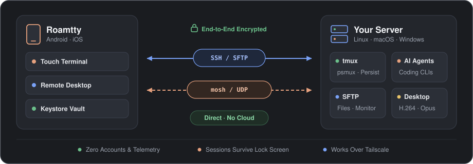
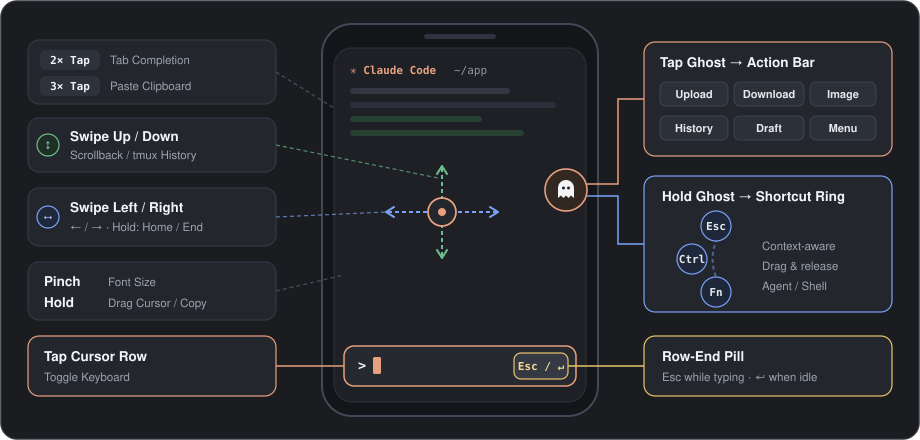
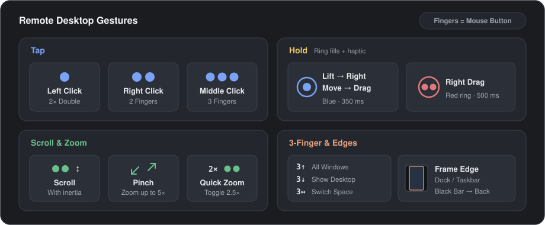

# Roamtty 使用指南

[English](USER_GUIDE.md) | **简体中文**

三步上手：**添加主机 → 启动 Agent 或终端 → 随时远程工作**。

> Roamtty 不自带模型，AI 工具运行在你自己的服务器上。如需公网外访问且不想暴露 SSH 端口，推荐搭配 [Tailscale](https://tailscale.com/)。

## 1. 添加主机

1. 打开 **主机** 页，点右上角 **+**。
2. 填写名称、地址（域名、局域网 IP 或 Tailscale `100.x.y.z`）、端口与用户名。
3. 选择 **密码**、**私钥**（Ed25519 / RSA，支持加密私钥）或 **交互式认证**。密码仅在主动勾选时加密保存，私钥口令永不落盘。
4. 会话模式保持默认的 **tmux**（推荐），点 **保存**。
5. 首次连接核对服务器 **SHA-256 指纹** 后点 **信任并连接**。

> 之后若指纹变化，Roamtty 会直接阻止连接。仅在确认服务器重装或更换密钥后，再通过主机菜单的 **重新核验** 放行。

主机卡片右侧 **⋮** 菜单可打开终端、查看文件、启动 AI Agent、安装插件（`tmux` / `psmux` 与 `mosh`）、编辑或删除主机。

## 2. 启动 AI Agent 或终端

打开 **会话** 页 → 点 **+**（或在主机卡片菜单直接发起）：

1. 选择 Agent（**Claude Code**、**Codex**、**Grok**、**Antigravity CLI**）或普通 **终端**。
2. 选择主机与起始文件夹。
3. 选择权限模式：
   - **计划 / 只读**：Claude Code 与 Antigravity 先制定计划；Codex 与 Grok 以只读沙箱运行。
   - **普通**：修改文件或执行命令前先征求确认。
   - **YOLO**：跳过所有确认（仅在受信任的环境中使用）。

会话列表按 **待确认**、**运行中**、**已完成** 分组，自动显示当前任务与状态。长按卡片可 **重命名** 或 **关闭**（每台主机最多 8 个会话）。

## 3. 终端手势与小幽灵

| 手势 / 操作 | 效果 |
| --- | --- |
| 点击光标所在行 | 弹出 / 收起键盘（点其他位置不弹出） |
| 双击 | 发送 `Tab` 补全，小幽灵旁出现方向键选择补全项 |
| 三击 | 粘贴剪贴板 |
| 左右滑动 | 发送 `←` / `→`（滑动后按住不放跳到行首 / 行尾） |
| 上下滑动 | 浏览历史输出（`tmux` 会话滚动远端历史） |
| 双指捏合 | 调整字号 |
| 长按 | 在命令行上用放大镜拖动光标；在其他输出上选择复制 |
| 单击链接 | 用浏览器打开（GitHub 链接优先使用 GitHub App） |
| **点按小幽灵** | 展开操作栏：会话菜单、上传、下载、插入图片（最多 9 张）、常用命令、编辑草稿、字号 |
| **长按小幽灵** | 弹出随前台程序变化的快捷键环（`Esc`、`Ctrl`、`Shift`、`F1–F12` 及 Agent 快捷键） |

光标行末尾常驻一个按键：输入时为 **Esc**，停止输入后切换为 **回车**。

## 4. 远程桌面

带图形界面的主机会在会话卡片和主机详情页显示 **桌面** 按钮。首次点击自动安装 `roamtty-desktop` 插件，无需手动配置。

- **操作模式**（`操作 → 操作方式`）：**屏幕触控**（默认，所点即所得）或 **鼠标指针**（触控板相对移动）。完整参数与手势见 [desktop-gestures.md](desktop-gestures.md)。
- **键盘**：**输入法** 页发送拼写完成的文本（含中文）；**电脑键盘** 页发送物理按键，支持修饰键单次锁定、长按常驻与组合键。
- **传输与保活**：优先走加密 UDP（60000–61000）+ FEC 纠错，被防火墙阻挡时 3 秒内自动回退 SSH。退出画面后后台保活（默认 10 分钟，可在设置中调整）。
- **独占控制**：同一台电脑同时只允许一台手机控制。

| 主机系统 | 要求 |
| --- | --- |
| Linux | X11，或 wlroots 系 Wayland（`sway`、`Hyprland`、`labwc`、`river`）。暂不支持 GNOME / KDE Wayland。 |
| macOS 13+ | 首次打开时在系统设置中为 *Roamtty Desktop* 开启 **屏幕与系统音频录制** 与 **辅助功能** 权限。 |
| Windows 10 1903+ / 11 | 需已登录桌面会话（以管理员运行 `roamtty-desktop.exe install` 可支持锁屏与登录界面）。 |

## 5. 文件、监控与端口预览

- **文件（SFTP）**：支持代码高亮、Markdown 与图片预览、文件内搜索、重命名、删除、上传、批量下载，以及在当前目录直接打开终端或启动 Agent；支持从系统相册分享图片直接上传到会话。
- **主机监控**：点击主机卡片实时查看 CPU、内存、磁盘、网络、GPU 与高占用进程。
- **端口预览**：点击终端输出中的 `localhost` 环回地址，通过按需 SSH 隧道直接在手机上预览远端本地 Web 服务。

## 6. 插件、设置与常见问题

- **安装插件**（主机 **⋮** → **安装插件**）：一键安装 `tmux` / `psmux`（断线保持任务）和 `mosh`（UDP 漫游，8 秒自动回退 SSH）。
- **设置**（侧边栏 → **设置**）：外观主题、内置或自定义 TTF/OTF 字体（附 Nerd Font 图标回退）、语言（`简体中文` / `English`）、下载目录及远程桌面保活时长。

| 常见问题 | 处理方式 |
| --- | --- |
| 锁屏后连接断开？ | 在系统设置中允许后台运行并豁免电池优化。使用 `tmux` 时即使断开，远端任务仍继续运行。 |
| 如何一键断开所有连接？ | 下拉通知栏，点击 Roamtty 通知上的 **全部断开**。 |
| 数据存储在哪里？ | 仅保存在本机。详见 [隐私政策](PRIVACY.md)。 |
