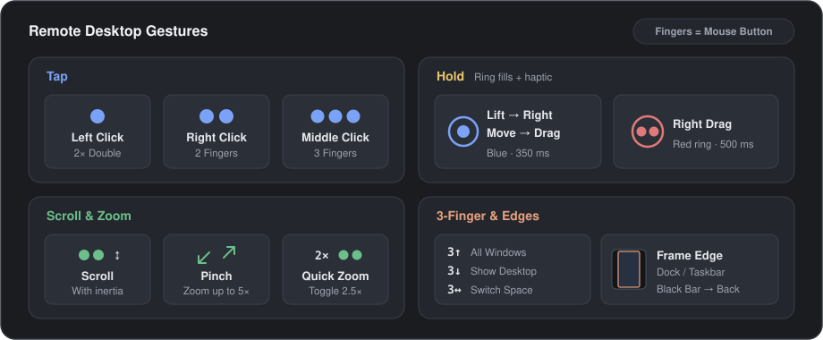

# Remote Desktop Gestures

How touches on the desktop screen map to host mouse and window input, modeled on Apple's trackpad.

- **Engine**: `desktop-core/src/main/kotlin/io/itermux/desktop/DesktopGestures.kt` (shared design with iOS `roamtty-ios`).
- **Tests**: Unit tests in `DesktopGesturesTest` match the tables below row by row; real multi-touch live tests run in `DesktopGestureLiveTest`.



## Design Principles

1. **Fingers = mouse button**: 1 finger left, 2 right, 3 middle.
2. **Taps act immediately**: nothing waits for a drag (only 2-finger tap waits 300 ms to distinguish 2-finger double-tap zoom).
3. **Hold picks up the button**: a ring fills with haptics (blue = 1 finger, red = 2 fingers); lift to right-click, move to drag.
4. **Picture vs. host**: pinch zooms only the local view; 2-finger slide always scrolls the host.
5. **Local-first cursor**: cursor renders locally with zero round-trip latency and syncs `CURSOR_POS` after 500 ms idle.
6. **Picture owns its edges**: swiping inward from the picture edge moves the cursor to the host edge (Dock/taskbar); swiping from black letterbox bars triggers Android system back (`Operations → Back` always works when zoomed).

## Gesture Reference

Switch between **Touch** (`屏幕触控`, default) and **Trackpad** (`鼠标指针`) under **Operations → Control mode**.

### Clicks & Holds

| Gesture | Touch mode | Trackpad mode |
| --- | --- | --- |
| 1-finger tap | Left click at finger | Left click at cursor |
| 1-finger double tap | Double click (2nd tap snaps within 300 ms / 20 dp) | Double click |
| 2-finger tap | Right click between fingers | Right click at cursor |
| 3-finger tap | Middle click between fingers | Middle click at cursor |
| 1-finger hold → lift | Right click (blue ring, 350 ms) | Right click (blue ring, 350 ms) |
| 1-finger hold → move | Left drag from finger | Left drag from cursor |
| 2-finger hold → move | Right drag (red ring, 500 ms) | Right drag (red ring, 500 ms) |

### Movement, Scrolling & Shortcuts

| Gesture | Touch mode | Trackpad mode |
| --- | --- | --- |
| 1-finger slide | Scroll under finger with inertia (pans picture first when zoomed) | Move cursor (velocity-scaled) |
| 2-finger slide | Scroll host with inertia (even when zoomed) | Scroll host with inertia |
| Pinch | Zoom picture up to 5× + pan (local only) | Same |
| 2-finger double tap | Toggle 2.5× zoom at point | Same |
| Picture edge swipe inward | Send cursor to host edge / hot corner | Same |
| Black bar edge swipe inward | System Back | Same |
| 3-finger swipe up / down | All windows (Mission Control / Task View / Activities) / Show desktop | Same |
| 3-finger swipe left / right | Switch desktop (`⌃→` macOS, `Ctrl+Win+→` Win, `Ctrl+Alt+→` Linux) | Same |
| 4+ fingers | Ignored | Ignored |

When zoomed in, the viewport auto-follows: trackpad keeps the cursor out of the outer 15%; touch drags near the edge auto-pan (up to 600 dp/s).

## Tuning Parameters

| Parameter | Value |
| --- | --- |
| Tap / hold slop | 10 dp |
| Hold duration | 350 ms (1 finger), 500 ms (2 fingers); ring appears at 200 ms |
| Double tap | ≤ 300 ms, ≤ 20 dp |
| Multi-finger tap | Lifted within 350 ms, no finger moved ≥ 10 dp |
| Scroll vs. pinch threshold | Centroid 12 dp / span 24 dp |
| Edge zone | Within 16 dp of picture edge, moving inward (Android caps edge exclusion at 200 dp/edge) |
| 3-finger swipe | Centroid 40 dp |
| Trackpad gain | `clamp(0.8 × (v / 150 dp/s)^0.6, 0.5, 4)` picture px per finger px |
| Scroll wheel | `2.5 / scale` (1/120 notch units) per dp, clamped `2..12`, batched ≥ 3 |
| Inertia | `0.998 / ms` deceleration; disabled after > 60 ms pause or < 50 dp/s |
| Haptics | Hold: `LONG_PRESS`; clicks/shortcuts: `KEYBOARD_TAP`; mode toggle: `VIRTUAL_KEY` |
| Cursor rendering | Absolute `INPUT abs` (no host accel); `CURSOR_SHAPE` rendered at 15–24 dp |

> macOS host plugin sets `kCGMouseEventClickState` on press/release so double-clicks register reliably; sub-notch wheel units accumulate to whole notches on X11/Wayland.

## Live Acceptance Test

Run `DesktopGestureLiveTest` against a real host (tests `touchModeGestures`, `trackpadModeGestures`, `showDesktopButtonEveryTap`, `swipeBackFromOutsideThePicture`):

```sh
./gradlew :app:installDebug :app:installDebugAndroidTest
adb shell am instrument -w -e class io.itermux.app.desktop.DesktopGestureLiveTest \
  -e gHost <HOST> -e gPort <PORT> -e gUser <USER> -e gPassword <PASS> \
  -e gOs LINUX -e gKeyType ssh-ed25519 -e gKey <BASE64_KEY> \
  com.roamtty.app.test/io.itermux.app.ItermuxTestRunner
```
